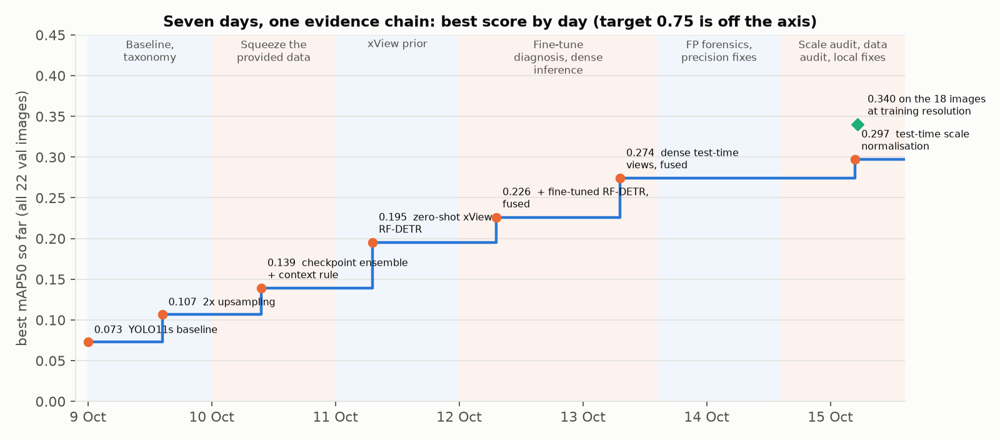
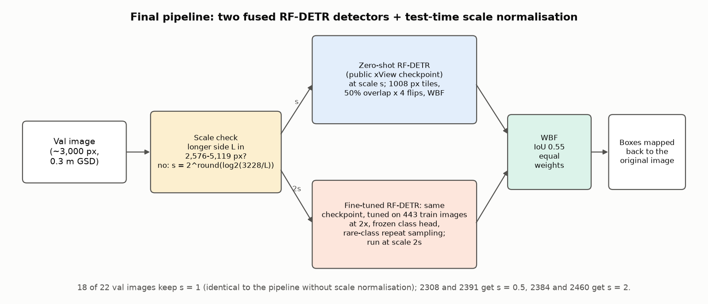
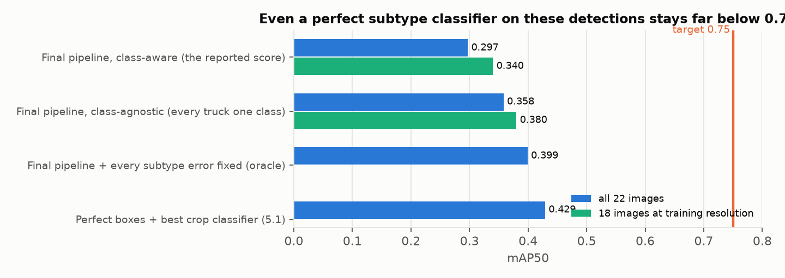
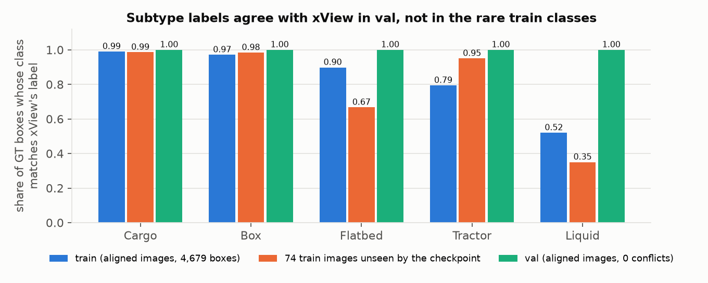
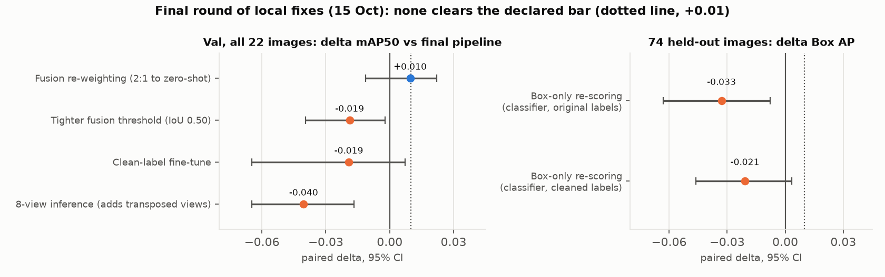

# Fine-grained truck detection in overhead imagery

*Auric AI Labs — Computer Vision Researcher assignment. Kranthi Kumar Sariputi. Submitted 15 Oct 2026.*
*Main report. Every number, method and run is documented in full in the technical appendix, `REPORT_FULL.pdf`.*

---

## Summary

**0.340 mAP50 (95% CI 0.240–0.429) on the 18 validation images at the training resolution, and 0.297 (0.203–0.370) on all 22 validation images: a fourfold improvement over the 0.073 YOLO11s baseline, built through hypothesis-driven experimentation, domain-specific pretraining and quantitative failure diagnosis.** The 18-image subset excludes four validation images that are rescaled about 2× relative to every training image (§3, Finding 4). The final pipeline fuses two RF-DETR detectors initialised from a public xView-pretrained checkpoint and normalises the scale of images outside the training size range. Each step was an individually tested gain: 2× upsampling +0.034, dense test-time views +0.069, fusion +0.048, scale normalisation +0.023.

The 0.75 target was not reached; the analysis shows where the remaining AP is lost and which experiment should come next. One caveat: the pretrained checkpoint's training data includes the validation imagery, so generalisation to external imagery is not yet verified.

**What I did**
1. **Built a frozen, verified evaluation pipeline on day 1:** full-image, class-aware AP50 matching pycocotools, paired image bootstraps for every comparison, and an adoption rule fixed before the second experiment.
2. **Ran 101 hypothesis-driven configurations in seven days.** Each was declared with its predicted effect before it was scored, on about 45 GPU-hours of free Kaggle and Colab GPUs, informed by 65 papers screened and 29 read in full.
3. **Built a 4× stronger pipeline through a chain of tested decisions** (upsampling, ensembling, an xView-pretrained RF-DETR, dense test-time views, fusion, scale normalisation), and diagnosed why fine-tuning on the 443 training images collapses the rare classes.
4. **Diagnosed three dataset inconsistencies, each measured,** and turned one into a fix. Four validation images are rescaled about 2× relative to all training images (a label-free rule from training image sizes recovers +0.023); the rare-class training labels disagree with xView's in one direction; about 16% of training boxes have no object under them.
5. **Answered all four research questions quantitatively** (§5): perfect boxes reach 0.43; hard examples split into a size problem and a confusion problem; 500 more random labels are worth about +0.001; the smallest tested subset reaching 90% of full-data performance is 80% of the labelled instances (300 selected images reach 96%).

**Table 1. Results** (COCO 101-point AP50, full images; 95% CI over images).

| Pipeline | 18 images at training resolution | All 22 validation images | Initialisation |
|---|---|---|---|
| **Final pipeline** | **0.340** (0.240–0.429) | **0.297** (0.203–0.370) | xView-pretrained RF-DETR |
| Same pipeline before scale normalisation | 0.340 (0.240–0.429) | 0.274 (0.175–0.357) | xView-pretrained RF-DETR |
| Best detector trained only on the provided images | 0.161 (0.090–0.268) | 0.139 (0.082–0.214) | COCO |
| Baseline (YOLO11s) | — | 0.073 (0.049–0.109) | COCO |

Per class (final pipeline, all 22): Cargo 0.226, Box 0.375, Flatbed 0.394, Tractor 0.042, Liquid 0.451.

---

## 1. Approach

- **Data.** 443 training and 22 validation images, about 3,000 px at 0.3 m; 7,618 and 1,552 boxes. Trucks are tiny (median 15–20 px on the short side), the classes are imbalanced 20:1 (Liquid has 20 validation boxes), and validation scenes are dense depots (median 76 boxes per image vs 7 in train).
- **Protocol, fixed on day 1.** One frozen evaluator (matches pycocotools; ground truth scores 1.000). A change is adopted only if the paired image-bootstrap Δ ≥ +0.01 with P(Δ > 0) ≥ 0.90. Every hypothesis, change and prediction was written into `experiments/LOG.md` before the first score.
- **How decisions were made.** Each experiment tested one hypothesis; error types were measured before choosing the next lever; competing explanations were tested rather than assumed; negative results were kept and used to redirect effort. Two independent references were kept throughout: a YOLO pipeline trained only on the provided data, and 74 training images the pretrained checkpoint never saw, which gate every classifier and re-scoring decision.
- **Scope.** Seven days; 101 configurations scored; about 45 GPU-hours on free Kaggle (2× T4) and Colab (T4) GPUs, plus a laptop for analysis; 65 papers screened and 29 read in full.

*Figure 1. Best score on all 22 validation images by the day it was logged, with the phase of work behind each step. Every step passed a rule declared before scoring.*

---

## 2. How the score was built

**Table 2. Each step, tested against the previous best with a paired bootstrap over images.**

| Step | Change | mAP50 (all 22) | Paired Δ (95% CI) |
|---|---|---|---|
| Baseline | YOLO11s from COCO, 640 px tiles | 0.073 | — |
| 2× upsampling | 2× upsampled tiles: the gain sits in trucks under 24 px | 0.107 | +0.034 (+0.002..+0.093) |
| Ensemble + context rule | 4-checkpoint ensemble (Weighted Boxes Fusion, WBF) + neighbourhood-class context rule | 0.139 | +0.032 (+0.005..+0.064) vs 2× upsampling |
| Zero-shot RF-DETR | RF-DETR from a public xView checkpoint, used without training | 0.195 | new detector prior |
| + fine-tuned RF-DETR | a fine-tuned copy (2×, frozen class head, rare-class sampling), fused with the zero-shot model | 0.226 | +0.031 (−0.010..+0.079) |
| Dense test-time views | the zero-shot model run on 50%-overlapping tiles × 4 flips | 0.264 | +0.069 (+0.019..+0.097) vs zero-shot RF-DETR |
| Dense views + fine-tuned model, fused | the dense-view model fused with the fine-tuned model | 0.274 | +0.048 (+0.020..+0.070) |
| **Scale normalisation (final pipeline)** | **images outside the training size range rescaled before inference** | **0.297** | **+0.023 (+0.003..+0.049)** |

*Figure 2. The final pipeline. An image whose longer side is outside the training range is rescaled by a power of two towards the training median; both RF-DETR members run at their own scale; boxes are fused and mapped back.*

**What fine-tuning alone revealed.** Fine-tuning the checkpoint on the 443 images scored 0.067–0.113, below zero-shot (0.195). A diagnosis chain with no extra training ruled out BatchNorm drift and train/eval mismatch, and showed that boxes got better while classes got worse: Flatbed, Tractor and Liquid are predicted as Cargo or Box even on the training images. The fused pipeline keeps the zero-shot model's class prior and adds the fine-tuned model's rare-class gains.

---

## 3. What limits the score

*Figure 3. The reported score against two ceilings computed from the same detections. Fixing every subtype error lifts the score only to about 0.40.*

**Finding 1 — Detection ranking is weak even when subtype is ignored.** Class-agnostic AP50 is 0.358 (0.380 on the 18). 72–100% of trucks are found at some confidence, but they are ranked below other vehicles and background: highly ranked false positives cost +0.119 AP. Using xView's own 60-class labels, 48–65% of the most damaging false positives turn out to be real vehicles (a neighbouring subtype, generic trucks, trailers), not clutter. Annotating the trucks missing from the validation labels turns only 6% of operating-point false positives into hits.

**Finding 2 — Subtypes are confused on correctly located trucks,** above all Tractor: only 26% of matched Tractor boxes get the right class (fixing subtype is worth +0.21 AP for Tractor, +0.10 overall). The confusion runs Cargo ↔ Box and rare → Cargo in every model tried, including classifiers given perfect boxes.

**Finding 3 — The rare-class training labels disagree with xView's.** Aligning xView's labels to our images and comparing classes box by box:

*Figure 4. Share of boxes whose class matches xView's label for the same object. Train agrees for Cargo and Box but only 0.79 for Tractor and 0.52 for Liquid; validation agrees for every class.*

The conflicts run one way (rare → Cargo/Box), matching the direction of the model's confusions, and about 16% of training boxes have no object under them. This inconsistency is measured; its causal contribution to the model's errors is not yet established, because a fine-tune on xView-corrected labels did not improve the score (§4).

**Finding 4 — Four validation images are rescaled about 2×.** Truck sizes in images 2308 and 2391 are 2.05–2.13× xView's, and in 2384 and 2460 0.50–0.55×; no training image is rescaled this way. In the enlarged pair, cars appear at the size of a typical training truck and are detected as Cargo Truck. The final pipeline normalises such images with a rule built from training image sizes only: +0.023, and never-detected trucks fall from 50 to 10.

---

## 4. What the other experiments established

Each idea was declared with a predicted effect before it was scored once. Results that did not pass the rule were kept, because each one settled a question and redirected the next experiment.

**Table 3. What each non-adopted experiment established, and the decision it led to.**

| Experiment | Result | What it established → decision |
|---|---|---|
| Longer training (100 epochs) | Δ −0.0001 | training length is not the limit (validation loss rises after about 30 epochs) → effort moved to resolution, ensembling and pretraining |
| A small-object (P2) head, 3× upsampling, a larger YOLO11m, an aerial (DOTA) backbone, a tiny-object loss (NWD), Faster R-CNN | none passed | the provided-data line plateaus at 0.139 regardless of architecture → move to a domain-specific prior (xView) |
| Fine-tuning the xView checkpoint alone | 0.067–0.113 vs 0.195 zero-shot | fine-tuning improves boxes but collapses the rare classes → keep the zero-shot model and fuse the fine-tuned one |
| Size-prior re-scoring (drop detections with non-truck size or shape) | Δ −0.004 | damaging false positives have truck geometry → look at what they are (xView forensics) instead |
| Crop-classifier fusion (re-score detections with a separate subtype classifier) | Δ −0.128 | a classifier weaker than the detector hurts → any future classifier must first beat the detector on held-out images |
| Two stand-alone subtype classifiers, tested on 74 unseen images | macro-recall 0.350 / 0.376 vs detector 0.370 | the gate worked: neither was fused; clean labels did help the classifier (Tractor 0.125 → 0.250) |
| Box-only re-scoring, tested on 74 unseen images | Box AP Δ −0.033 / −0.021 | the detector's own scores rank best → validation never touched |
| 8-view inference (adds transposed views to the 4 flips) | Δ −0.040 | the dense-view gain is saturated at 4 flips → stop adding views |
| Fusion re-weighting (2:1 towards the zero-shot model) | Δ +0.010, P 0.84 | a consistent but sub-threshold gain → not adopted; noted as a candidate for a larger validation set |
| Clean-label fine-tune (on xView-corrected labels) | Δ −0.019 (−0.065..+0.007) | inconclusive: cleaning also cut Liquid training boxes by 29% → the next step is an expert audit with counts held equal |

*Figure 5. The final round of local fixes, each against the final pipeline (left) or on 74 images the checkpoint never saw (right). None clears the declared bar.*

---

## 5. Research investigations

**5.1 — Perfect localisation.** A crop classifier given ground-truth boxes reaches **0.43 mAP50** (ConvNeXt-T; DINOv2 0.40; a satellite-pretrained DINOv3 0.35). Even with perfect boxes, more than half the AP is lost to subtype classification, with the same Cargo ↔ Box and rare → Cargo confusions. Train/val shift, head capacity and classifier family were each tested and ruled out as the cause.

**5.2 — Hard training examples.** Dataset cartography over 11 checkpoints splits them into two populations: **hard-missed** (581 instances, median 13.7 px: a size problem) and **hard-confused** (975 instances, consistently assigned another class: 89% of Liquid, 45% of Flatbed, 35% of Tractor). Whether an instance will be learned is predictable on a frozen holdout (AUC 0.70 from size alone, 0.82 with early training dynamics). The hard-confused directions match the label disagreements of Finding 3.

**5.3 — Value of 500 more labels.** A learning curve over nested random subsets gives **+0.015 mAP50 per doubling** of data (95% CI +0.006..+0.025), so **500 more random labels ≈ +0.0014**: smaller than the seed-to-seed spread. A labelling budget is better spent on auditing the rare-class labels and on targeted Tractor and Liquid examples.

**5.4 — Smallest subset reaching 90% of full performance: 80% of the labelled instances.** At 12.5%, 25% and 50% no subset passed (50% random gives 73%). Following the declared rule's provision for one extra size, an 80% subset was then trained under the same recipe, and both arms passed the 0.079 bar (90% of full data): **the selected subset scored 0.085 (96% of full) with 300 images (68% of the images, 79% of the instances)**, and the random subset 0.080 (91%) with 357 images. Selected vs random is +0.005 (CI −0.007..+0.016), so the rule ties random here, after losing at 25%, where it had removed the small, confused trucks that validation is full of. Selected vs full data is −0.003 (CI −0.019..+0.010). This is the smallest successful size tested, not a proven minimum: sizes between 50% and 80% were not tested, each arm is one seed, and the random arm passes by a margin smaller than the seed spread seen at smaller sizes.

---

## 6. Conclusions and next step

- **Supported by measurement:** detection ranking is the first bottleneck and subtype confusion (Tractor above all) the second; the rare-class training labels disagree with xView's while validation agrees; image scale matters, and normalising it helps.
- **Open:** whether the label inconsistency causes the rare-class collapse, and how the pipeline performs on external imagery.
- **Ruled out by experiment:** that more resolution or views close the gap; that post-hoc re-scoring fixes subtypes; that missing validation annotations explain the false positives; that more random labels are a good buy.

**Next step: an expert audit of the rare-class training labels.** Two annotators, blind to both label sources, label about 400 stratified Tractor, Liquid and empty boxes under a written visual protocol. If the audit confirms the noise, retrain on the audited labels with rare-class counts held equal and 3 seeds per arm, gated on held-out images before validation. Then score the final pipeline once on an untouched test set from outside xView.

---

## 7. Deliverables and reproduction

**Table 4. Final model and artefacts.**

| Item | Detail |
|---|---|
| Final pipeline | WBF (IoU 0.55, equal weights) of the zero-shot and fine-tuned members, with test-time scale normalisation: images with longer side outside 2,576–5,119 px rescaled by s = 2^round(log₂(3,228 / longer side)) |
| Zero-shot member | public RF-DETR xView checkpoint (`ShotaroFukunaga/rfdetr_xview`, `1008/checkpoint0099.pth`), zero-shot; 1008 px tiles, 50% overlap, 4 flips, WBF; classes mapped to xView ids 11 / 12 / 15 / 13 / 16 |
| Fine-tuned member | the same checkpoint fine-tuned on the 443 training images at 2×, class head frozen, rare-class repeat sampling, 5 epochs; `weights/rfx3_ep5.pt` |
| YOLO reference | YOLO11s, 2× tiles, WBF of epochs 40 / 60 / 80 / last + context rule; `weights/E2_*.pt` |
| Reproduce | `bash reproduce_rfx.sh` (final pipeline, expected 0.2975; re-run from the documented commands before submission and reproduced exactly, per class included); `bash reproduce.sh` (YOLO line, expected 0.139). Weights are checksummed in `weights/SHA256SUMS*` |
| Evidence | every scored configuration with its declared prediction in `experiments/LOG.md`; metrics in `experiments/results/`; full diagnostics in `REPORT_FULL.pdf`, which also maps these names to the run codes used there (Table 0) |

**Limitations.** The pretrained checkpoint's training data includes the validation imagery, so external generalisation is not yet verified. The validation set is 22 images (per-class claims for Tractor and Liquid are thin; differences under about 0.02 are not resolved). The best configuration was selected on validation, models are single-seed, and the 18-image subset was identified by a validation audit. Full discussion in `REPORT_FULL.pdf` §7 and §13.
