# Fine-grained truck detection in overhead imagery

*Auric AI Labs — Computer Vision Researcher assignment. Kranthi Kumar Sariputi. Submitted 15 Oct 2026.*
*Technical appendix: the complete record behind the main report (`REPORT.pdf`).*

---

## Abstract

**0.340 mAP50 (95% CI 0.240–0.429) on the 18 validation images at the training resolution, and 0.297 (0.203–0.370) on all 22 validation images: a fourfold improvement over the 0.073 YOLO11s baseline, built through hypothesis-driven experimentation, domain-specific pretraining and quantitative failure diagnosis.** The 18-image subset excludes four validation images that are rescaled about 2× relative to every training image (§5.4). The final pipeline (SC1) fuses two RF-DETR detectors initialised from a public xView-pretrained checkpoint and normalises the scale of images outside the training size range. Each step was an individually tested gain: 2× upsampling +0.034, dense test-time views +0.069, fusion +0.048, scale normalisation +0.023.

The 0.75 target was not reached; the analysis shows where the remaining AP is lost and which experiment should come next. One caveat: the pretrained checkpoint's training data includes the validation imagery, so generalisation to external imagery is not yet verified.

**Task.** The task is to detect five truck subtypes (Cargo Truck, Truck w/Box, Truck w/Flatbed, Truck Tractor, Truck w/Liquid) in about 3,000 px satellite images at 0.3 m ground sampling distance, with a target of 0.75 mAP50, and to answer four research questions about the failure modes.

Where the remaining AP is lost:
- **Detection ranking is weak even when subtype is ignored.** Class-agnostic AP50 is 0.358 (0.380 on the 18), so a perfect subtype classifier on these detections would still score about 0.40.
- **Subtypes are confused on correctly located trucks,** above all Tractor: only 26% of matched Tractor boxes get the right class.
- **The training labels for the rare classes are inconsistent with xView's.** They agree with xView's labels for the same boxes only 52% (Liquid) and 79% (Tractor) of the time, while the validation labels agree 100%, and about 16% of training boxes have no object under them. The inconsistency is measured; its causal contribution to the model's errors is not yet established (§7).

The report closes with what is supported, what is open, what was rejected, and the one experiment that should come next: an expert audit of the rare-class training labels.

### What I did

1. **Built a frozen, verified evaluation pipeline on day 1:** full-image, class-aware AP50 matching pycocotools, paired image bootstraps for every comparison, and an adoption rule fixed before the second experiment.
2. **Ran 101 hypothesis-driven configurations in seven days.** Each was declared with its predicted effect before it was scored, on about 45 GPU-hours of free Kaggle and Colab GPUs, informed by 65 papers screened and 29 read in full.
3. **Built a 4× stronger pipeline through a chain of tested decisions** (upsampling, ensembling, an xView-pretrained RF-DETR, dense test-time views, fusion, scale normalisation), and diagnosed why fine-tuning on the 443 training images collapses the rare classes.
4. **Diagnosed three dataset inconsistencies, each measured,** and turned one into a fix. Four validation images are rescaled about 2× relative to all training images (a label-free rule from training image sizes recovers +0.023); the rare-class training labels disagree with xView's in one direction; about 16% of training boxes have no object under them.
5. **Answered all four research questions quantitatively** (§8): perfect boxes reach 0.43; hard examples split into a size problem and a confusion problem; 500 more random labels are worth about +0.001; the smallest tested subset reaching 90% of full-data performance is 80% of the labelled instances (300 selected images reach 96%).

---

## How to read this report

- **Metric.** Unless stated otherwise, every number is full-image, class-aware COCO 101-point AP50 from one frozen evaluator (`src/evaluate.py`). It matches pycocotools to 4 decimal places, and the ground truth fed in as predictions scores 1.0000.
- **Two scores.** *22* is the full validation set. *18* is the subset at the training resolution, which excludes 4 images rescaled about 2× relative to every training image (criterion: image size only, §5.4). Both are reported together throughout.
- **Uncertainty.** CIs are 95% bootstrap intervals over images (2,000 resamples). Δ is a paired image-bootstrap difference (`src/compare.py`), so image difficulty cancels. P is the bootstrap probability that Δ > 0.
- **Records.** Every configuration ever scored is in `experiments/LOG.md`, with the prediction written before it was scored. Figures are generated from saved results by `src/make_figures.py` and `src/make_story_figures.py`. References are numbered in square brackets [n].
- **Names.** E* are YOLO runs, RFX* are RF-DETR runs, and FINAL2 / SC1 are the final pipelines. Appendix A lists every run.

**Table 0. Names used in the main report, and the run codes used in this appendix and in `experiments/LOG.md`.**

| Name in the main report | Code here |
|---|---|
| Final pipeline (scale normalisation) | SC1 |
| Same pipeline before scale normalisation; dense views + fine-tuned model, fused | FINAL2 |
| Baseline | E0 |
| 2× upsampling | E1 |
| Ensemble + context rule (best detector trained only on the provided images) | ENS_E2_ctx |
| Zero-shot RF-DETR | RFX0 |
| + fine-tuned RF-DETR, fused | ENS_RFX03 |
| Dense test-time views (the zero-shot member) | RFX0D |
| Fine-tuned RF-DETR (the fine-tuned member) | RFX3 (RFX3_ep5) |
| Size-prior re-scoring | SP1 |
| Crop-classifier fusion | T2 |
| Stand-alone subtype classifiers | CB1 (original labels), CB2 (cleaned labels) |
| Box-only re-scoring | BX |
| 8-view inference | R8 |
| Fusion re-weighting; tighter fusion threshold | FU1_SC; FU2_SC (FU1–FU3 on FINAL2) |
| Clean-label fine-tune | RFX3c, and SC1c for the pipeline built with it |
| Annotation-omission test | GTO |
| Learning-curve and subset runs | LC_rand_*, LC_sel_*, LC_full_* |

---

## 1. Summary

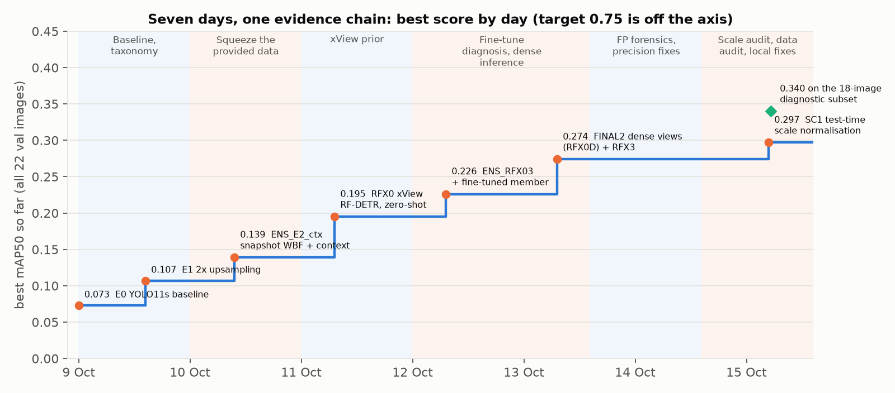

*Figure 1. The project as one evidence chain: the best score on all 22 validation images by the day it was logged, with the phase of work behind each step. Every step passed a rule declared before it was scored. The green diamond is the final pipeline on the 18 images at the training resolution.*

**Table 1. Results.**

| Pipeline | 18 images at training resolution | All 22 validation images | Initialisation | What it is |
|---|---|---|---|---|
| **SC1 (final)** | **0.340** (0.240–0.429) | **0.297** (0.203–0.370) | xView-pretrained RF-DETR | FINAL2 + test-time scale normalisation |
| FINAL2 | 0.340 (0.240–0.429) | 0.274 (0.175–0.357) | xView-pretrained RF-DETR | WBF of zero-shot RF-DETR (dense views) and a fine-tuned copy |
| **ENS_E2_ctx** (best trained only on provided images) | 0.161 (0.090–0.268) | **0.139** (0.082–0.214) | COCO | YOLO11s, 2× tiles, 4-checkpoint WBF, context rule |
| Baseline (E0) | — | 0.073 (0.049–0.109) | COCO | YOLO11s, native-resolution tiles |

**Per class, SC1 on all 22:** Cargo 0.226, Box 0.375, Flatbed 0.394, Tractor 0.042, Liquid 0.451. On the 18: Cargo 0.247, Box 0.415, Flatbed 0.411, Tractor 0.048, Liquid 0.578.

**What a reviewer should take away:**
1. **Each gain was individually tested on the validation set.** Each step in Figure 1 passed a paired test: 2× upsampling +0.034 (CI +0.002..+0.093), dense test-time views +0.069 (+0.019..+0.097), FINAL2 over the previous best +0.048 (+0.020..+0.070), scale normalisation +0.023 (+0.003..+0.049). These are validation-set results from single training seeds; they have not been confirmed on an untouched test set or across seeds.
2. **The gap to 0.75 is explained by measurement, not by assertion** (§7). The bottleneck is detection ranking and subtype confusion; the rare-class training labels are measurably inconsistent with xView's while the validation labels are consistent.
3. **Negative results are reported with the same care as positive ones.** Of the ideas tried after FINAL2, one was adopted and eight were rejected, each against a rule fixed in advance (§6). Two subtype classifiers were tested on 74 images the checkpoint never saw before they were allowed near the validation set.
4. **The four research questions have quantitative answers** (§8): perfect boxes give 0.43; hard examples split into a size problem and a confusion problem; 500 more random labels are worth about +0.001; the smallest tested subset reaching 90% of full-data performance is 80% of the labelled instances (300 selected images reach 96%).

---

## 2. The problem and the data

### 2.1 Task

Detect and classify five truck types in overhead images, evaluated by mAP50 on a held-out validation split, with a stated target of ≥ 0.75. The brief also asks for a failure taxonomy, four investigations (5.1–5.4), weights, code and a README.

### 2.2 Dataset

**Table 2. Dataset at a glance.**

| | Train | Val |
|---|---|---|
| Images | 443 | 22 |
| Image size | about 3,000 px; longer side 2,576–5,119 px | about 3,000 px; 4 images outside the train range (about 1,400 px and about 7,100 px) |
| Boxes | 7,618 | 1,552 |
| Boxes per image: min / median / 90th pct / max | 0 / 7 / 41 / 451 | 8 / **76** / 141 / 167 |
| GT box overlapping another GT box | 37% | 49% |

**Table 3. Classes: count, share and median box size (longer × shorter side, px).**

| Class | Train n (%) | Val n (%) | Train size | Val size |
|---|---|---|---|---|
| Cargo Truck | 3,773 (49.5) | 800 (51.5) | 23 × 15 | 30 × 16 |
| Truck w/Box | 2,366 (31.1) | 493 (31.8) | 48 × 22 | 44 × 25 |
| Truck w/Flatbed | 662 (8.7) | 122 (7.9) | 36 × 18 | 44 × 18 |
| Truck Tractor | 625 (8.2) | 117 (7.5) | 25 × 14 | 26 × 17 |
| Truck w/Liquid | 192 (2.5) | **20 (1.3)** | 33 × 19 | 53 × 31 |

Three properties shape everything that follows:
- **The objects are tiny.** The median truck is 15–20 px on its short side. Resizing a 3,000 px image to a 640 px input would shrink a truck to about 3 px, so every pipeline here tiles the image.
- **The classes are imbalanced 20:1, and per-class validation AP rests on very few images.** Liquid is 20 boxes in 8 images, and for Flatbed, Tractor and Liquid the top 3 images hold 59–66% of the validation boxes. Per-class differences under about 0.05 are not interpretable for these classes.
- **Validation is denser than training.** Val is depot and parking scenes (median 76 boxes per image against 7 in train). Train has only 11 images with ≥ 97 boxes.

### 2.3 What the class definitions are

The brief says class definitions are supplied with the dataset. What the dataset contains is `classmap.txt`, which maps ids 0–4 to the five names and gives no visual criteria (for example, what separates a Cargo Truck from a Truck w/Box at 15–30 px). Ambiguous examples could therefore be judged only against the labels themselves. The five names are verbatim xView categories [1], and every image id lies in xView's labelled range, which later made it possible to compare our labels with xView's (§2.5).

### 2.4 Dataset forensics (`src/dataset_forensics.py`, `src/eda.py`)

- **No train–val near-duplicates** (pHash distance ≤ 6 for 0 image pairs).
- **Gross label errors are rare:** 14 same-class duplicates (0.2%) and 8 different-class overlaps at IoU ≥ 0.5 (0.1%) in train; none in val. Subtype mislabels do not show up in this check; they do in §2.5.
- **Size alone does not classify:** a nearest-median-size classifier scores 0.41 on val, below the 0.52 majority-class baseline.
- **Neighbours predict class.** The majority class of a box's GT neighbours within 150 px matches its own class 89% of the time on val (77% on train), against 0.59 for a crop classifier that sees only the box. This motivated the context rule of §4.2.
- **Twelve hidden train outliers:** 12 of 353 measurable train images have a truck-size ratio to xView that is off by more than 25% (for example image 2493 at 2.29) although their image size is normal.

### 2.5 Label quality, measured against xView (`src/data_audit.py`, `src/align_xview.py`)

xView's own 60-class annotations [1] for our images were aligned to our pixel coordinates (328 train images by identity, 8 by a fitted scale and offset; 102 could not be aligned). For every GT box with an xView box at IoU ≥ 0.5, the two class labels were compared.

*Figure 2. Share of GT boxes whose subtype matches xView's label for the same object. Agreement is near perfect for Cargo and Box everywhere, but falls to 0.79 (Tractor) and 0.52 (Liquid) in train. Validation agrees for every class (0 conflicts). The inconsistency is also present in the 74 train images the RF-DETR checkpoint never saw (Flatbed 0.67, Liquid 0.35), so it is not specific to one xView split.*

- **The conflicts run one way, from rare to common.** Of 100 checked Liquid boxes, xView calls 25 Cargo and 16 Box; of 247 Tractor boxes, 32 are Cargo and 14 Box in xView; of 431 Flatbed boxes, 31 Cargo and 11 Box. Our Cargo boxes are 99% consistent. In total about 203 of 4,679 aligned train boxes (4.3%) conflict, concentrated in the rare classes.
- **About 16% of train GT boxes have no xView object under them** (best IoU < 0.1; about 1,190 boxes); val has none. A visual check of 24 random examples (Figure 3) shows about half are real trucks xView does not label, and the rest are oversized boxes merging 2–3 trucks, cars labelled Cargo or Tractor, or near-empty ground. They cannot simply be deleted.
- **Coverage.** xView labels in-class trucks that our GT omits: 4.7% of GT in train and 10.3% in val. Their effect on the score is measured directly in §5.2 (GTO).

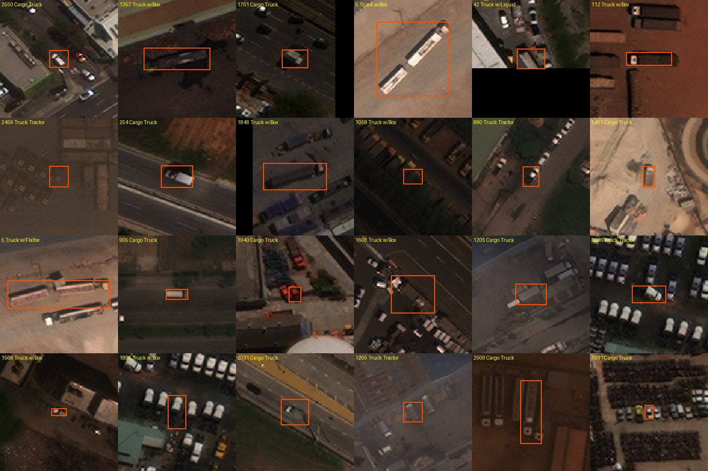

*Figure 3. Twenty-four random train GT boxes with no xView object under them. About half are real trucks; the rest are merged boxes, cars, or ground.*

These measurements came late (15 Oct), after most of the modelling. They reframe several earlier results, notably why every fine-tune collapsed on the rare classes (§4.3).

---

## 3. Research approach

### 3.1 Protocol, fixed on day 1

- **One frozen evaluator** (`src/evaluate.py`, 9 Oct): COCO 101-point AP50, class-aware, on full images. Tile-level mAP from training frameworks overstates the score (E0: 0.098 tile-level vs 0.073 full-image), so it is never reported.
- **Decision rule, fixed 9 Oct before the second experiment:** a change is adopted only if the paired Δ ≥ +0.01 with P(Δ > 0) ≥ 0.90 against the current best. When several candidates are tested together, the probability threshold is Bonferroni-corrected (P ≥ 0.967 for three).
- **Declared before scored.** Every experiment's hypothesis, change, prediction and decision rule were written into `experiments/LOG.md` before its first score. Where a prediction was wrong, the log and this report say so.
- **No test set,** so the reported best is selected on validation and is an optimistic estimate. Validation labels were never used for training or tuning, and parameters were fixed from train data or library defaults. Weights are reported at the last epoch, never at the val-selected best epoch.
- **Pretrained checkpoint and independent references.** The public RF-DETR checkpoint was trained on xView, whose training split includes the 22 validation images, so the RF-DETR scores are development results. Two independent references are kept throughout: the YOLO pipeline, which never saw xView labels, and **74 of our train images the checkpoint never saw** (`experiments/splits/rfx_heldout_train_ids.txt`), which are used for every classifier and re-scoring decision in §6.

### 3.2 Scope of work

**Table 4. Timeline.** The dataset arrived on 9 Oct 2026 at 13:21; the report was submitted on 15 Oct.

| Date | Phase | Best (all 22) |
|---|---|---|
| 9 Oct | Data audit, frozen evaluator and splits, YOLO11s baseline, failure taxonomy, 5.1 and 5.2 | 0.073 → 0.107 |
| 10 Oct | Training length, P2 head, TTA, snapshot ensembles, context, learned context, Faster R-CNN, 5.3 / 5.4, literature probes | 0.139 |
| 11 Oct | External review round; multi-label output; xView-pretrained RF-DETR | 0.195 |
| 12 Oct | Fine-tune collapse diagnosis, head re-mapping, class-conditional fusion, RFX3 | 0.226 |
| 13 Oct | Dense test-time views, WiSE-FT, logit probe, DINOv3 satellite probe, FP forensics with xView labels, SP1, CS1 | 0.274 |
| 14 Oct | T2 crop-classifier fusion, GTO omission test, FP cost breakdown | 0.274 |
| 15 Oct | Scale audit and SC1, error budget, data audit and label cleaning, held-out classifier benchmark, final round of local fixes, report | **0.297** (diagnostic subset: 0.340) |

**Table 5. Compute.** About 45 GPU-hours in total, all on free tiers.

| Platform | GPU-hours | Used for |
|---|---|---|
| Kaggle, 2× NVIDIA T4 (16 GB) | about 30 | Most YOLO training (E1, E2, S1, learning curves, probes), RF-DETR fine-tunes (RFX1, RFX3, RFX3c), dense RF-DETR inference, R8 |
| Google Colab, 1× T4 | about 15 | Baseline E0, Faster R-CNN, RFX2 pilot, train-set inference for the learned context model |
| Apple M5 laptop (MPS) | — | Evaluation, all analysis, crop classifiers, SC1 inference, fusion |

**Effort in numbers.** 101 configurations scored on validation, from about 40 training runs plus inference-only variants; a 2,000-resample paired bootstrap for every comparison; 60 pipeline and analysis scripts in `src/`; a hypothesis ledger tracked from declaration to verdict (§9).

### 3.3 Literature process

- **65 distinct papers** were screened across three adversarially verified searches (each claim checked by three independent reads) and a citation crawl of the xView paper (`experiments/LITERATURE.md`, `report/literature.md`).
- **29 were read in full** (`experiments/LITERATURE_FULLREAD.md`), with notes and verified numbers. Topics: benchmarks and labelling [1, 16, 17]; tiny and fine-grained aerial detection [13, 14, 18, 19, 20]; slicing and resolution [4, 5, 6, 7]; label noise [15, 31]; long-tail calibration [21]; test-time adaptation [22]; remote-sensing foundation models and open-vocabulary detectors [23–30].
- **What the literature changed in the project** is listed in §10.

---

## 4. The modelling story

### 4.1 Act I — Baseline and failure taxonomy (9 Oct)

**Baseline E0.** YOLO11s [44] from COCO weights, 640 px tiles with 128 px overlap cut at full resolution (boxes kept if ≥ 50% visible), 50 epochs, Ultralytics defaults; sliced full-image inference with class-wise NMS 0.5. Colab T4, 1.9 h.

**Result: 0.073 (0.049–0.109).** Per class: Cargo 0.124, Box 0.180, Flatbed 0.054, Tractor 0.003, Liquid 0.004.

**Table 6. Where the AP goes: TIDE-style oracle ΔAP [33] (fix one error type, re-score).**

| Error type | E0 | E1 |
|---|---|---|
| Classification | **+0.245** | **+0.218** |
| Background false positive | +0.083 | +0.100 |
| Localisation | +0.014 | +0.018 |
| Duplicate | 0.000 | 0.000 |

- **Subtype classification was the largest single loss from the start.** Re-scoring at IoU 0.3 instead of 0.5 adds only +0.014, so box quality is not the problem.
- **A size-as-class shortcut.** At epoch 10 the model predicted almost only Box (the large class): Cargo boxes ≥ 32 px were 0% Cargo, 26% Box and 74% missed.
- **Small trucks are missed rather than misclassified.** Within each class, recall rises with size (Box: 0.00 below 16 px, 0.30 above 32 px).

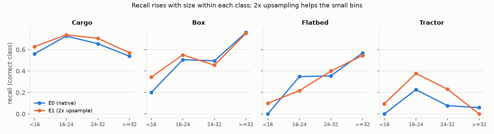

*Figure 4. Recall (correct class, any confidence) by GT box size within each class, for the baseline (E0) and 2× upsampling (E1). Recall rises with size; upsampling recovers the small bins.*

### 4.2 Act II — Squeezing the provided data (9–10 Oct)

Each change below was one variable against the current best, declared before scoring.

**Table 7. YOLO line (all 22 images).**

| Run | Hypothesis / change | mAP50 | Paired Δ (95% CI), P | Verdict |
|---|---|---|---|---|
| **E1** | H1, too few pixels: 2× upsampled tiles (imgsz 1280) | **0.107** (0.067–0.173) | +0.034 (+0.002..+0.093), 0.985 vs E0 | **supported** |
| E1-2stage | subtype errors are head capacity: E1 boxes + ConvNeXt-T crop classifier | 0.1065 | ≈ 0 | rejected |
| E2 | H6, under-training: 100 epochs | 0.107 | −0.0001 (−0.023..+0.033), 0.47 | rejected; prediction missed |
| TTA | flip test-time augmentation, NMS merge | 0.101 | −0.006 (−0.029..+0.013), 0.40 | rejected |
| S1 | P2 head + weak scale augmentation (stacked) | 0.090 | −0.017 (−0.084..+0.019), 0.21 | rejected; not attributable |
| E1_ctx | H12, neighbours predict class: context smoothing (R 150 px, α 0.5) | 0.125 | +0.018 (+0.009..+0.029), 1.00 | **supported** |
| ENS_E2 | snapshot WBF of E2 epochs 40/60/80/last [32, 51] | 0.129 | +0.022 (+0.009..+0.034), 1.00 | **supported** |
| **ENS_E2_ctx** | ENS_E2 → context | **0.139** (0.082–0.214) | +0.010 (+0.001..+0.020), 0.99 | **supported; best on provided data** |
| CTXM | learned context model (logistic regression on 21 features) | 0.138 | −0.001 (−0.011..+0.010), 0.42 | rejected |
| ENS_multi | more diverse ensemble members | 0.144 | +0.005 (−0.003..+0.012), 0.92 | rejected (< +0.01) |
| ML arms | multi-label detector output | 0.141 | +0.002 (−0.003..+0.008), 0.78 | redundant with context |
| FRCNN | is the YOLO family the limit? Faster R-CNN R50-FPN [45], 2× | 0.075 | −0.032 (−0.092..+0.006) vs E1 | same class profile, lower |
| P3 (25% data) | 3× upsampling / YOLO11m / DOTA backbone [17] | 0.059 / 0.048 / 0.044 | pass rule ≥ 0.064 | all fail |
| P4 (25%) | NWD tiny-object assignment and loss [10] | 0.049 | −0.002 (−0.011..+0.008) | fail; patch verified active |
| P5 (25%, 2 seeds) | clean P2-only probe | 0.0474 mean | vs 0.0520 random | no detectable effect |

- **Upsampling helped where expected:** gains concentrate below 24 px (Figure 4), consistent with SAHI's 2–4× slicing [4] and with nearest-neighbour upscaling matching learned super-resolution [7].
- **Context smoothing is a real signal, not an artefact.** Two controls rule out the obvious confounds: with α = 0 (same NMS and multi-row output, no neighbour information) the gain vanishes (+0.0004), and image-level calibration without neighbour classes gives −0.005 (H13 rejected). The radius was first chosen on val GT; re-run on train GT only, the same criterion picks the same radius (Figure 5).
- **Overfitting sets in early.** Validation classification loss bottoms at epochs 20–30 and then rises while train loss keeps falling (Figure 6), which is why E2 (100 epochs) did not help.
- **A lesson recorded at the time:** S1 bundled three changes to save GPU time, which made its negative result impossible to attribute. The clean P2-only re-test (P5) later found no effect.

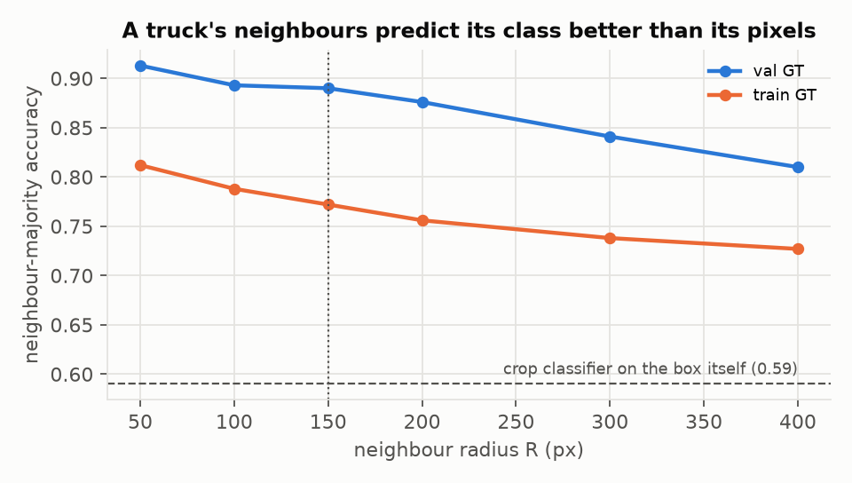

*Figure 5. Accuracy of the neighbour-majority class against neighbourhood radius, on train and val GT. The dashed line is a crop classifier that sees only the box (0.59). Spatial class consistency is strong on val (0.89 at 150 px) and weaker on train (0.77).*

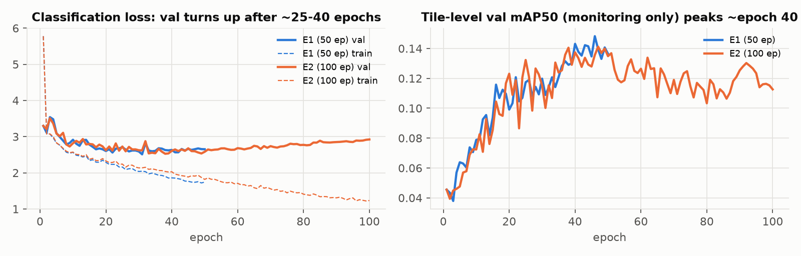

*Figure 6. Classification loss and tile-level mAP over training for E1 (50 epochs) and E2 (100 epochs). Validation classification loss rises after about 25–40 epochs.*

**Where Act II ended.** Every in-repo lever was small (+0.018 to +0.034), all reused the same 443 images, and two investigations (5.1: perfect boxes still give only 0.43; 5.3: +500 labels ≈ +0.001) pointed to a shortage of labelled examples of these exact classes rather than to a model limit.

### 4.3 Act III — The xView prior (11–13 Oct)

**Hypothesis.** A detector that has already seen xView's far larger pool of labelled trucks carries a class prior that 443 images cannot teach. Published support: multi-resolution training on xView lifted Truck Tractor from 0.005 to 0.21 and Truck w/Liquid from 0.018 to 0.47 [1].

**Source.** The public checkpoint `ShotaroFukunaga/rfdetr_xview` [49] (`1008/checkpoint0099.pth`): RF-DETR [43] with a DINOv2-windowed-small encoder [41], 1008 px crops, 62 classes, EMA weights. It was loaded with `weights_only=True` and rebuilt in `rfdetr` 1.11.2 with 0 unexpected keys. The class mapping (Cargo 11, Box 12, Flatbed 15, Tractor 13, Liquid 16) was fixed on train images only, before any validation number.

**Table 8. RF-DETR line (all 22 images).**

| Run | Change | mAP50 (CI) | Verdict |
|---|---|---|---|
| **RFX0** | zero-shot, 1008 px tiles, overlap 128 | **0.195** (0.116–0.279) | new best (vs 0.139) |
| RFX0_s2 | same at 2× | 0.038 | the prior is scale-specific |
| Head re-mapping | route classes to the most frequent fired ids | 0.16–0.17 | rejected: those ids are generic Truck classes |
| RFX1 | fine-tune on 443 images, 10 epochs | 0.067 | collapse |
| RFX2 | fine-tune at 2×, 3 epochs (Colab pilot) | 0.095 | better than RFX1, still collapsed |
| ENS_RFX | WBF(RFX0, RFX1) | 0.188 | rejected |
| Class-conditional fusion | RFX0 classes, RFX1 boxes | Δ +0.005 (−0.003..+0.012) | not adopted |
| RFX3 | fine-tune at 2×, frozen class head, rare-class repeat sampling [36], 5 epochs | 0.113 (Liquid 0.225) | best Liquid of any single model |
| **ENS_RFX03** | WBF(RFX0, RFX3) | **0.226** (0.133–0.317) | Δ +0.031 (−0.010..+0.079), P 0.925: provisional |
| STK1 | RFX0 + context rule | 0.194 | context adds nothing on a transformer decoder |
| W1 | WiSE-FT weight average of RFX0 and RFX3 [40] | 0.143 | rejected |
| Logit probe | train-fitted linear probe on the 63 logits | 0.143 | rejected (−0.052 vs RFX0) |
| DINOv3-SAT gate | frozen satellite foundation model [47] on GT crops | 0.351 oracle-box | below the 0.43 of 5.1: stopped |
| V1 | public YOLOv8m xView checkpoint at its own protocol | 0.010 | dropped |
| **RFX0D** | RFX0 with 50% tile overlap × 4 flips, WBF | **0.264** (0.163–0.352) | Δ +0.069 (+0.019..+0.097), P 0.995: **supported** |
| **FINAL2** | WBF(RFX0D, RFX3) | **0.274** (0.175–0.357) | Δ +0.048 (+0.020..+0.070), P 1.00 vs ENS_RFX03: **supported** |
| RFX3D / FINAL3 | flip views on the fine-tuned member too | 0.133 / 0.276 | FINAL3 +0.002 vs FINAL2: rejected |

**Why fine-tuning collapsed the prior: a diagnosis chain with no extra training.**
1. *BatchNorm drift?* Restoring the checkpoint's statistics gives 0.056. Ruled out.
2. *Train/eval mode mismatch?* Losses agree in both modes. Ruled out.
3. *Boxes or classes?* Class-agnostic AP fell only from 0.238 to 0.183; the localisation oracle term fell (0.089 → 0.034, boxes improved) while the classification term rose (0.108 → 0.186).
4. *On the training images themselves,* Flatbed, Tractor and Liquid are predicted as Cargo or Box. Freezing the class head did not stop it, so the drift lives in the features.

At the time, the working explanation was class imbalance under the checkpoint's focal loss. The label audit of §2.5, done two days later, adds a second candidate that fits the same pattern: the rare-class train labels conflict with xView's in exactly the common-class direction (rare → Cargo/Box). DN-TOD reports the same mechanism under synthetic class-shift noise: rare-class AP collapses while frequent classes barely move [15]. RFX3c (§6.4) tested it directly.

**Why the fusion works.** The two members fail differently: the zero-shot model keeps the xView prior (Box, Flatbed), the fine-tuned model adds Liquid (+0.12). Against RFX0D alone the fine-tuned member is not shown to add anything overall (Δ +0.010, CI −0.022..+0.056); it trades Flatbed (−0.05) for Liquid.

### 4.4 Act IV — Diagnosing the remaining error (13–15 Oct)

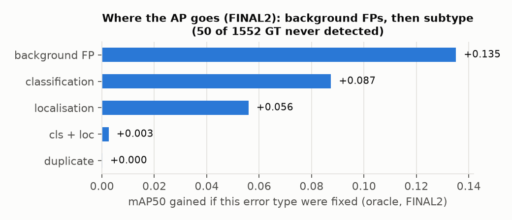

*Figure 7. Oracle ΔAP by error type for FINAL2: the AP regained if every error of one type were fixed in isolation (overlapping upper bounds, not additive).*

The full diagnosis is in §5. In short: highly ranked background false positives were the largest term, they concentrated on two upsampled images, and an image-size audit found four validation images rescaled about 2× relative to every training image. A label-free rule fixed from training image sizes (SC1, §5.4) recovered +0.023.

### 4.5 Act V — Targeted local fixes and the data audit (15 Oct)

With SC1 as the safe baseline, the last day went into looking for a *local* change: one whose effect could be proven on independent images before it touched validation, rather than another global change that trades one class for another. §6 reports that round: three fusion variants, rotation views, two subtype classifiers benchmarked on held-out images, Box-only re-scoring, and a fine-tune on xView-cleaned labels. None cleared the bar.

### 4.6 The final pipeline

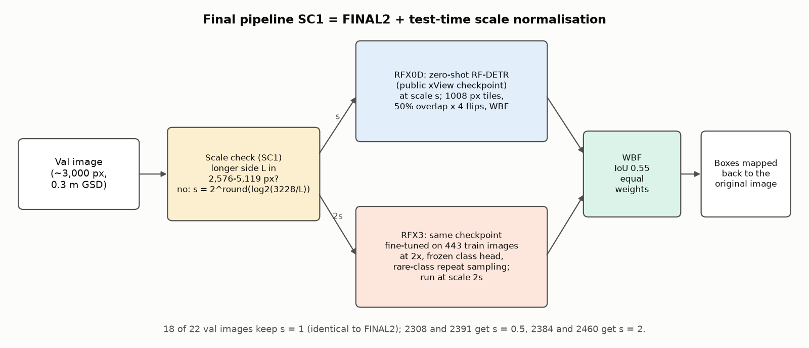

*Figure 8. The final pipeline SC1. An image whose longer side is outside the training range is rescaled by a power of two towards the training median; both RF-DETR members run at their own scale; their boxes are fused with Weighted-Boxes-Fusion [32] and mapped back.*

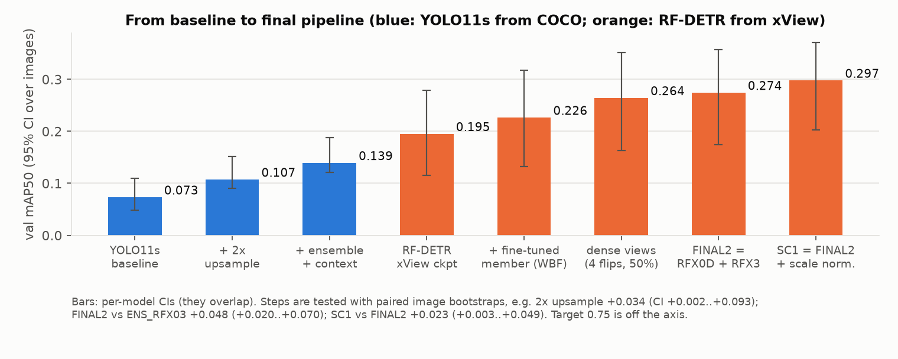

*Figure 9. From baseline to final pipeline, with per-model 95% CIs. The per-model CIs overlap; each step is tested with a paired image bootstrap instead.*

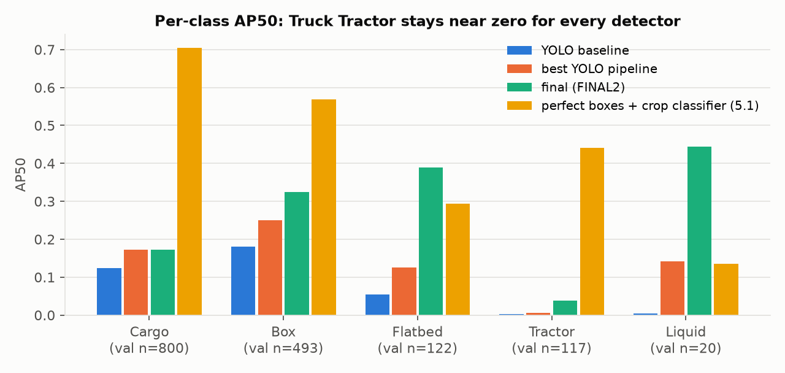

*Figure 10. Per-class AP50 for the YOLO baseline, the best YOLO pipeline, FINAL2, and a crop classifier given perfect boxes (5.1). Truck Tractor stays near zero for every detector.*

---

## 5. Diagnosis: what limits the measured result

*The analyses in §5.1–5.4 were run on FINAL2, before SC1; they are what led to SC1.*

### 5.1 What the damaging false positives are (`src/fp_forensics.py`)

xView's 60-class annotations let us look under every top-ranked false positive. The analysis uses the 13 validation images whose xView labels align with our GT (≥ 80% of GT matched at IoU 0.5) and the top 400 false positives per class.

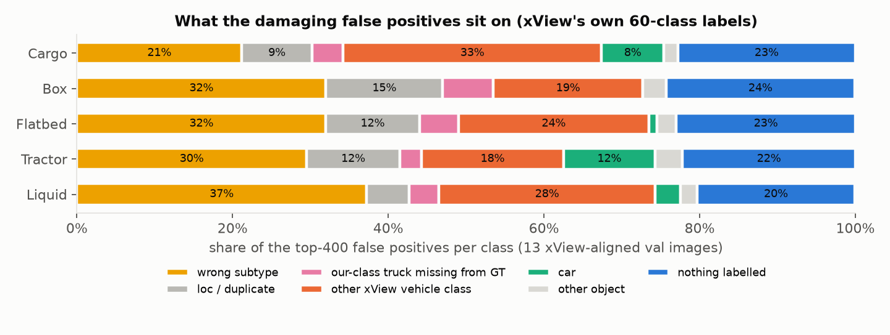

*Figure 11. What the top-400 false positives per class sit on, according to xView's own labels (13 aligned val images).*

1. **Most damaging false positives are vehicles, not clutter.** Wrong-subtype trucks plus vehicles of xView classes outside the task (generic Truck, Trailer, Bus) make up 48–65% of them. These are model errors under the task definition.
2. **Definite annotation omissions are a small share.** xView labels 113 trucks of our 5 classes in the aligned region that our GT does not contain (about 11% of GT). They account for 3–7% of the top-ranked false positives.
3. **The subtype boundary is plausibly ambiguous.** In xView's naming, Box, Flatbed and Liquid are "Truck Tractor w/ Box Trailer / Flatbed Trailer / Liquid Tank", so the tractor cab appears in four of the five classes. xView labellers fall back to the parent class when unsure, and quality control accepted batches at precision 0.75 / recall 0.95 [1].

### 5.2 GTO: do missing annotations explain the false positives? (`src/gt_omission_test.py`)

The frozen predictions were scored twice on the 13 aligned images: with the original GT, and with the 96 omitted in-class xView trucks added. Only the GT differs.

**Table 9. Annotation-omission test.**

| Model (13 aligned images) | Original GT | + omitted trucks | Δ (paired 95% CI) | FPs at conf ≥ 0.25 that become TPs |
|---|---|---|---|---|
| FINAL2 (xView checkpoint) | 0.417 | 0.471 | +0.055 (+0.015..+0.075) | 43 / 702 (6%) |
| YOLO pipeline (never saw xView) | 0.240 | 0.255 | +0.016 (−0.018..+0.028) | 19 / 258 (7%) |

- **With the omissions annotated, about 94% of operating-point false positives remain errors.** Omissions are a minor term.
- **The two gains differ** (difference +0.039, CI +0.001..+0.071, P 0.98). Part of FINAL2's gain reflects the checkpoint's familiarity with xView's labels; for the independent model the effect is not distinguishable from zero.
- **My prediction was wrong:** I declared +0.01 to +0.04 for FINAL2; the measured +0.055 is above it.

### 5.3 Which false positives cost the AP (`src/fp_breakdown.py`, `src/image_audit.py`)

**Table 10. AP regained by deleting one error type at a time (FINAL2, all 22 images).**

| Class | AP | Delete background FPs | Delete wrong-subtype | Delete localisation | Delete duplicates |
|---|---|---|---|---|---|
| Cargo | 0.173 | +0.290 | +0.015 | +0.006 | 0.000 |
| Box | 0.325 | +0.161 | +0.047 | +0.018 | +0.001 |
| Flatbed | 0.390 | +0.133 | +0.024 | +0.026 | 0.000 |
| Tractor | 0.038 | +0.054 | +0.003 | +0.005 | 0.000 |
| Liquid | 0.444 | +0.037 | +0.002 | 0.000 | 0.000 |
| **Mean** | **0.274** | **+0.135** | +0.018 | +0.011 | 0.000 |

- **Background false positives carry most of the cost,** above all for Cargo.
- **They concentrated in two images.** 2308 and 2391 produced 33% of all false positives at confidence ≥ 0.25 but hold 12% of GT. They are about 7,100 × 5,700 px, and a visual check showed cars and vans predicted as Cargo Truck at confidence 0.35–0.46 (Figure 12).
- **Image-level attribution.** Native-scale dense depots carry about 80% of the false-positive cost (2293 +0.014, 2472 +0.012, 1447 +0.010, 2470 +0.008, 1206 +0.007); the upsampled 2308 (+0.010) and 2391 (+0.008) are in the top group (Figure 13).

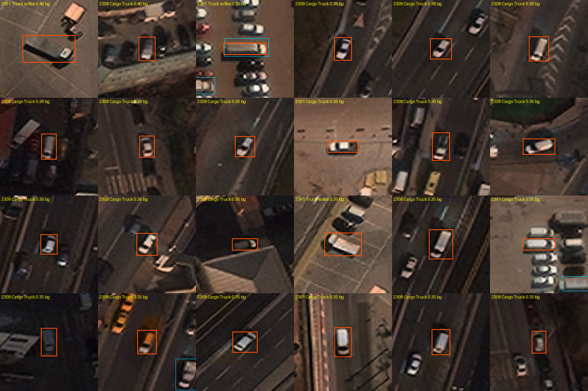

*Figure 12. The 24 highest-ranked false positives in images 2308 and 2391 (orange: prediction; blue: nearby GT). Most are cars and vans enlarged to the size of a typical training truck.*

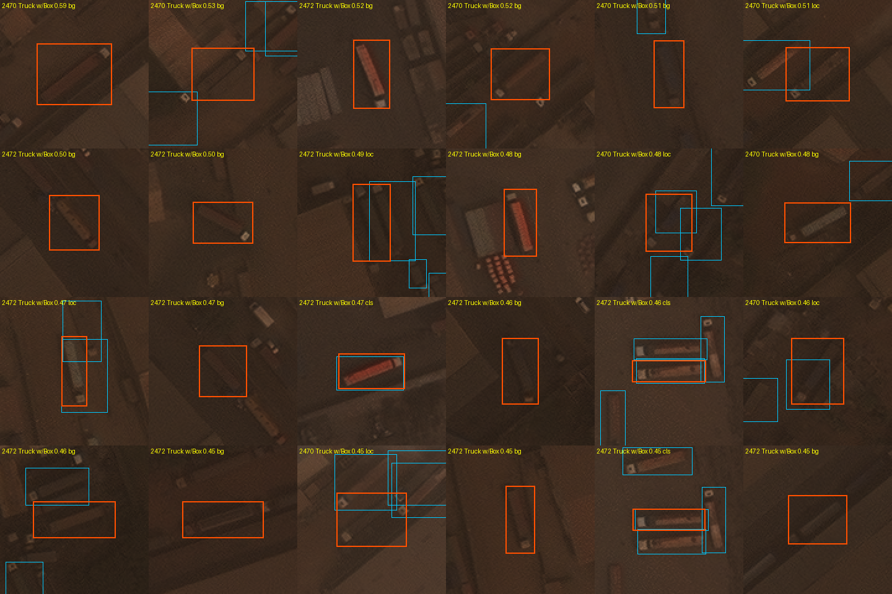

*Figure 13. The 24 highest-ranked false positives in the native-scale depot images 2293, 2472, 1447 and 2470. These are mostly real vehicles: trucks of a neighbouring subtype, generic trucks and trailers.*

### 5.4 Scale audit and SC1 (`src/sc1.py`, `src/subset_map.py`)

**Finding.** Comparing our GT truck sizes with xView's labels for the same images gives a size ratio of 2.05–2.13 for 2308 and 2391 (upsampled about 2×) and 0.50–0.55 for 2384 and 2460 (about 1,400–1,600 px; downsampled about 2×). The other 17 checkable images lie at 0.97–1.10. **No train image is rescaled this way:** all 443 have a longer side of 2,576–5,119 px, and these 4 are the only validation images outside that range. In the upsampled pair, cars (about 11 px in xView) appear about 23 px, the size of a typical train truck; in the downsampled pair, trucks shrink to 9–16 px.

**SC1 rule, from train image sizes only, declared before scoring.** An image whose longer side is outside 2,576–5,119 px is rescaled by s = 2^round(log₂(3,228 / longer side)) before inference (BOX filter when s < 1), and boxes are mapped back. On validation this selects exactly the 4 rescaled images; the other 18 keep their FINAL2 predictions.

**Result: 0.297 vs 0.274, Δ +0.023 (paired CI +0.003..+0.049), P 0.995 → adopted.** Cargo +0.052 and Box +0.050 carry the gain; GT never detected falls from 50 to 10. Prediction (+0.01 to +0.04) met. *Caveat:* the hypothesis came from the validation audit, so the gain is val-motivated even though the rule uses no validation labels or tuned parameters.

**Diagnostic subset.** Excluding the 4 images by the same image-size criterion gives an 18-image score (Table 1). Because the criterion was found through a validation audit, the subset is not an independent test set. It is reported only as a diagnostic of what the scale mismatch costs; the all-22 score is the primary result.

### 5.5 Error budget of the final pipeline (`src/error_budget.py`)

**Table 11. SC1 error budget (all 22 images; oracle gains are overlapping bounds and must not be added).**

| Class | AP50 | Recall, any conf | Recall @ conf ≥ 0.25 | Subtype accuracy on matched boxes | Oracle: fix subtype | Oracle: delete background FPs |
|---|---|---|---|---|---|---|
| Cargo | 0.226 | 0.89 | 0.29 | 0.78 | +0.083 | +0.221 |
| Box | 0.375 | 0.94 | 0.51 | 0.67 | +0.110 | +0.155 |
| Flatbed | 0.394 | 0.93 | 0.42 | 0.61 | +0.070 | +0.133 |
| Tractor | 0.042 | 0.72 | 0.02 | **0.26** | **+0.210** | +0.051 |
| Liquid | 0.451 | 1.00 | 0.30 | 0.10 | +0.039 | +0.036 |
| **Mean** | **0.297** | | | | **+0.102** | **+0.119** |

- **Coverage is high, ranking is not.** 72–100% of GT are found at some confidence, but few at a usable one. Fixing boxes is worth +0.064 and recovering never-detected GT only +0.019.
- **Class-agnostic AP50 is 0.358** (0.276–0.446) against 0.297 class-aware: ranking trucks against everything else is weak even with subtype ignored.
- **AP regained by deleting each false-positive cause** (13 aligned images): wrong subtype on a GT truck +0.025; an in-class truck the GT omits +0.020; nothing labelled +0.020; background in images without xView reference +0.019; poor localisation +0.016; generic or non-target trucks +0.010; other vehicles +0.005.
- **Correction of an earlier reading.** Counts in the five worst depot images had suggested generic trucks were the main background cause (29% of their false positives). Weighted by AP over all aligned images they are a minor term (+0.010), so explicit generic-truck negatives were not pursued.
- **Confusions on matched boxes:** Cargo → Box 123, Box → Cargo 134, Tractor → Cargo 36, Tractor → Box 25.

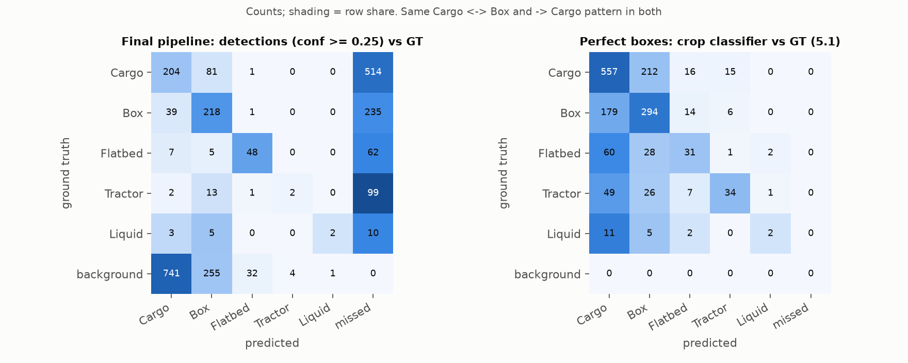

*Figure 14. Confusion matrices: the final pipeline's detections at confidence ≥ 0.25 (left) and a crop classifier given perfect boxes (right). The same Cargo ↔ Box and rare → Cargo pattern appears in both.*

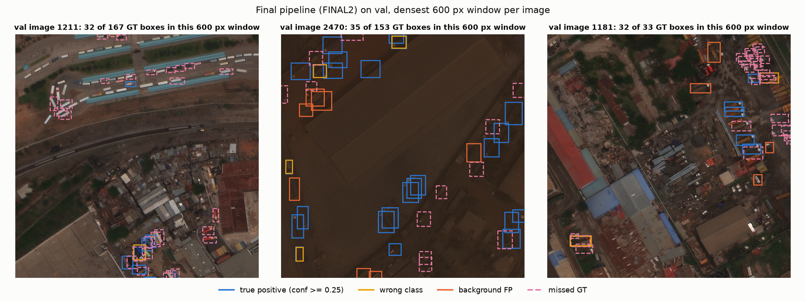

*Figure 15. FINAL2 on validation, densest 600 px window of three images: true positives (blue), wrong class (yellow), background false positives (orange) and missed GT (dashed pink).*

---

## 6. Fixes tried after FINAL2

Each idea was declared in `LOG.md` with a predicted effect and scored once.

### 6.1 Adopted

**SC1, test-time scale normalisation** (§5.4): +0.023 (+0.003..+0.049), P 0.995.

### 6.2 Rejected on validation (13–14 Oct)

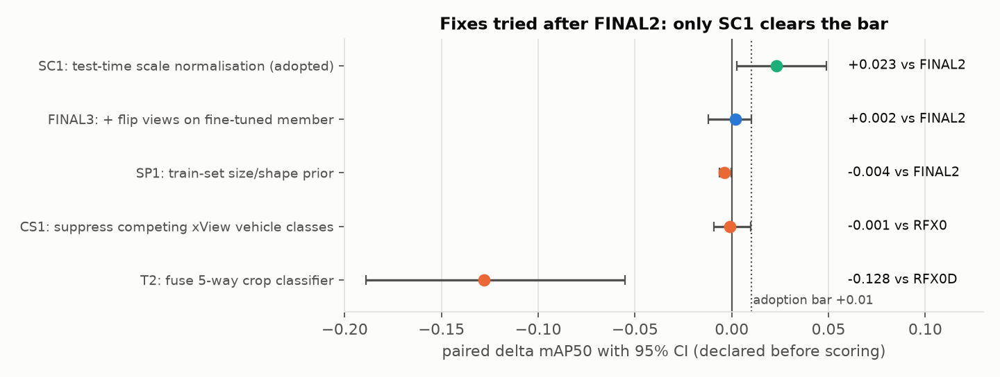

*Figure 16. The first round of fixes after FINAL2, each with its paired Δ and 95% CI against the reference shown. Only SC1 clears the +0.01 bar.*

**Table 12. First round.**

| Run | Mechanism (fixed before scoring) | Result | Why it failed |
|---|---|---|---|
| FINAL3 | flip views on the fine-tuned member too | 0.276, Δ +0.002 (−0.012..+0.010) | trades Liquid for Box/Flatbed |
| SP1 | per-class size and shape prior from train boxes | 0.271, Δ −0.004 (−0.007..−0.000) | the damaging false positives have truck geometry |
| CS1 | down-weight a class when the head fires on a competing xView vehicle class | 0.194, Δ −0.001 (−0.009..+0.010) vs RFX0 | the head's competitor scores are confused in the same way |
| T2 | fuse a ConvNeXt-T [42] crop classifier, √(detector × classifier) | 0.136, Δ −0.128 (−0.189..−0.055) | the classifier (59% accuracy on GT crops) is weaker than the detector's own class scores |

### 6.3 Is there a label-free signal for re-ranking? (`src/fp_signal.py`)

Before building another re-scorer, I checked whether any label-free feature separates high-ranked false positives from true positives *beyond confidence* (AUC within confidence deciles; 0.5 = no signal). On validation: box side 0.50–0.60, aspect 0.49–0.56, local density 0.46–0.55, and the margin between a box's own class score and the best other class 0.55–0.67. The only candidate (margin) was then checked on the 74 held-out train images: 0.42–0.51. **No signal generalises, so no re-ranking rule was evaluated on validation.**

### 6.4 The final round of local fixes (15 Oct)

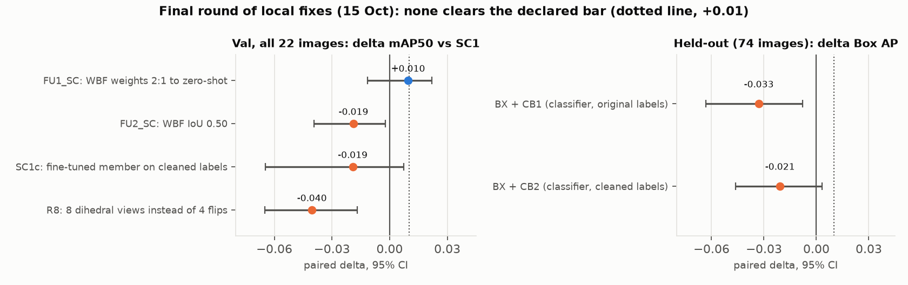

*Figure 17. The final round. Left: paired Δ in mAP50 against SC1 on all 22 validation images. Right: paired Δ in Box AP on the 74 held-out train images (Box-only re-scoring never reached validation because it failed here).*

**Table 13. Final round, each declared before scoring.**

| Run | Mechanism | Result | Verdict and reading |
|---|---|---|---|
| FU1_SC | WBF weights 2:1 towards the zero-shot member | 0.307, Δ +0.010 (−0.011..+0.022), P 0.84 | consistent small gain on two baselines, but fails P ≥ 0.967 (3 candidates): **not adopted** |
| FU2_SC | WBF IoU 0.50 instead of 0.55 | 0.279, Δ −0.019 (−0.039..−0.002) | rejected: tighter clustering hurts |
| FU3 | per-class source, chosen from val deltas | 0.287 on FINAL2 (+0.013) | val-selected by construction: diagnostic only |
| R8 | 8 dihedral views instead of 4 flips | 0.257, Δ −0.040 (−0.065..−0.017) | rejected; Flatbed −0.123. With 8 views, WBF penalises boxes found by only some views more (hypothesis) |
| CB1 | subtype crop classifier (original labels), benchmarked on 487 boxes of the 74 held-out images | macro-recall 0.350 vs detector 0.370; Tractor 0.125 vs 0.208 | fails the declared win; not integrated |
| CB2 | same, trained on xView-cleaned labels | macro-recall 0.376; Tractor 0.250; Cargo-vs-Box 0.702 vs 0.737 | fails; but clean labels help (Tractor 0.125 → 0.250) |
| BX | re-score Box detections only with CB1 / CB2 (other classes cannot move) | held-out Box AP Δ −0.033 (−0.063..−0.008) / −0.021 (−0.046..+0.003) | fails on independent images, so never run on validation |
| SC1c | SC1 with the fine-tuned member retrained on cleaned labels (RFX3c) | 0.278, Δ −0.019 (−0.065..+0.007), P 0.13 | rejected; Liquid −0.101 (−0.317..+0.012, 20 GT boxes) |
| M504 | the checkpoint's 504 px variant (6 held-out images) | 0.030 vs 0.160 | trucks shrink to 8–15 px: dropped |

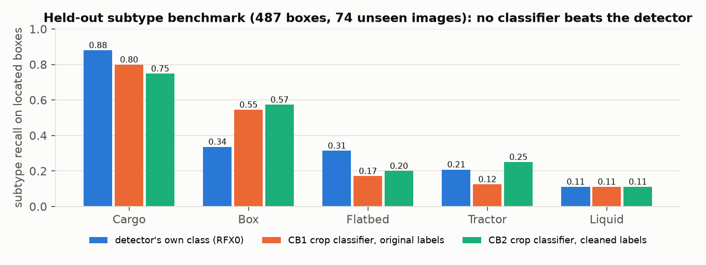

*Figure 18. Held-out subtype benchmark on 487 located boxes from the 74 images the checkpoint never saw. The crop classifiers beat the detector on Box but lose on Cargo, Flatbed and Tractor; neither meets the declared win (macro-recall +0.05 and Tractor +0.10 over the detector).*

**What the round shows.** Post-hoc re-scoring of these detections does not separate the classes: the detector's own class scores rank better than any fused classifier, on validation (T2) and on independent images (BX). The fine-tune on cleaned labels did not repair the rare classes; §7 explains why that result is not yet evidence that cleaning is harmful.

---

## 7. Not reached vs not reachable

That none of 101 configurations reached 0.75 does not prove the target is unreachable. The case rests on three measurements of the evaluation itself.

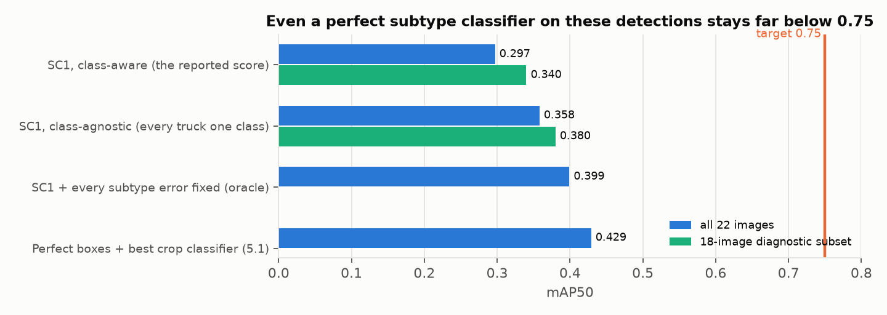

*Figure 19. The reported score against two ceilings computed from the same detections, and a perfect-box reference. Fixing every subtype error lifts the score only to about 0.40.*

1. **A ceiling for subtype fixes.** Class-agnostic AP50 (every truck treated as one class) is **0.358** (0.276–0.446) on all 22 images and **0.380** (0.287–0.481) on the 18. The oracle that fixes every subtype error on located boxes lifts the class-aware score from 0.297 to about 0.40. A perfect subtype classifier on top of these detections therefore stays far below 0.75. This bounds the present detectors, not every possible detector: the bottleneck is detection ranking (separating trucks from other vehicles and background) as much as subtype.
2. **The evaluator is not the cap.** Validation subtype labels agree with xView 100% and have no empty boxes (§2.5). The xView trucks missing from validation GT are worth +0.016 (−0.018..+0.028) to an independent model (§5.2). The low score is a model result on clean evaluation labels. (xView's own labels are only a reference: their quality-control precision was 0.75 [1].)
3. **Why cleaning the train labels lowered the score (SC1c).** Three explanations compete:
   - *The cleaned labels moved the model away from a noisy validation distribution.* **Ruled out:** validation agrees with xView, so cleaning moved train towards validation.
   - *Cleaning removed rare-class examples.* Relabelling to xView's class cut train Liquid boxes from 192 to 136 (−29%) and Tractor from 625 to 577 (−8%), and Liquid is where SC1c lost. A count-matched control would discriminate: the same cleaned labels with the rare-class repeat factor raised to restore the original counts.
   - *Run-to-run noise.* The Liquid loss has CI −0.317..+0.012 on 20 GT boxes, from one seed. Two or three seeds per arm would discriminate.

   Neither discriminating run fitted in the remaining time, so "cleaning is harmful" is **not** concluded. Equally, the result does not show that the inconsistency causes the errors: the cleaning procedure, xView's reference labels (themselves imperfect) or the retraining setup could each hide a benefit or create a loss. What is established is narrower: **the label inconsistency is measured; its causal contribution to the model's failures is not.**

**Selection bias.** 101 configurations were scored on validation, so the best is inflated by selection, and its CI does not capture that. Two observations limit the concern: the adopted pipeline sits on a plateau rather than a lone peak (six detector configurations lie within 0.02 of SC1, all variants of the same two-model fusion: FU1_SC 0.307, SC1 0.297, FU3 0.287, FU1 0.284, FU2_SC 0.279, SC1c 0.278), and SC1 is not the highest scorer (FU1_SC was higher but failed the rule). The 18-image subset was defined after the audit, a second selection step. The paired bootstrap compares two pipelines on the same images, but it neither removes this selection optimism nor captures training-seed variance: every full-data model is a single seed. **Both 0.297 and 0.340 should therefore be read as optimistic validation estimates.** SC1 is the best-supported configuration on this validation set, not a demonstrated robust performance level; an untouched test set and multi-seed confirmation would be needed for that.

**External context.** No paper we found reports anything near 0.75 for these classes under a comparable protocol. The xView baseline reports per-class AP of 0.005–0.474 for these trucks depending on the variant [1]; the 2018 challenge winners reached about 0.29–0.32 mAP over 60 classes [2]; a 2025 benchmark of 11 modern detectors found about 0.18–0.20 AP50 on xView at best [8]. Protocols differ, so these are indicative only.

---

## 8. Research investigations 5.1–5.4

*What this data can resolve.* With 22 validation images, differences below about 0.02 are not resolved. 5.3 and 5.4 were run on the YOLO recipe (full-data score 0.088 at 30 epochs), so "90% of full" means 0.079: the 80% subsets pass it by margins of 0.0006 (random) and 0.006 (selected), within the seed spread seen at smaller sizes. Results are stated as directions with intervals, and per-class orderings only where the CIs separate.

### 8.1 (5.1) Perfect localisation: how much of the problem is classification? (`src/oracle_cls.py`)

**Method.** A crop classifier trained on the 7,618 train GT boxes (square crops of 2× the box's longer side, minimum 48 px, resized to 128 px; flips and rot90; label smoothing 0.1; AdamW one-cycle, 15 epochs, no val-based selection; 8-way TTA). Every validation GT box is emitted once per class with the class probability as confidence, and scored by the same evaluator ("oracle-box mAP50").

**Table 14. Perfect-box classifiers.**

| Classifier | Accuracy | Macro-recall | Oracle-box mAP50 (CI) |
|---|---|---|---|
| ConvNeXt-T, ImageNet-22k [42] | 0.592 | 0.388 | **0.429** (0.347–0.532) |
| DINOv2 ViT-S [41] | 0.571 | 0.334 | 0.399 (0.329–0.510) |
| DINOv3 ViT-L, 493M satellite images, frozen linear probe [47] | 0.553 | 0.324 | 0.351 (0.286–0.432) |

- Per class (ConvNeXt): Cargo 0.705, Box 0.568, Tractor 0.441, Flatbed 0.294, Liquid 0.136 (2 of 20).
- Confusions: Cargo → Box 212, Box → Cargo 178, Flatbed → Cargo 60, Tractor → Cargo 49 (Figure 14, right).
- **Competing explanations tested and weakened:** train→val shift (held-out train accuracy 0.63 vs val 0.59); head capacity (the classifier on detector boxes scores 0.1065 vs 0.107 for the detector alone); classifier family (three different backbones land at 0.55–0.59 with the same confusions).
- **Answer:** even with perfect boxes, more than half the AP is lost to subtype classification. 0.43 is what one protocol achieves, a lower bound on what is achievable, not a ceiling. In light of §2.5, part of this loss plausibly reflects training-label inconsistency in exactly the confused direction.

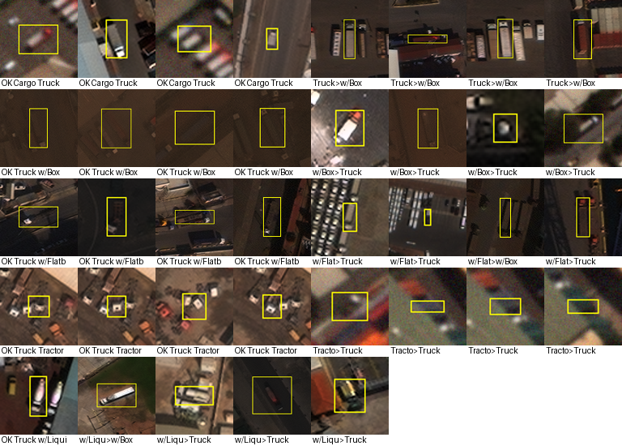

*Figure 20. Examples of validation GT crops with the crop classifier's prediction. Many Box and Cargo crops are hard to tell apart at this resolution.*

### 8.2 (5.2) Hard training examples (`src/cartography.py`)

**Method.** Dataset cartography [34] over 11 checkpoints of E0 (epochs 0–45 and last) on all 7,618 train instances: per instance, the correct-class confidence at IoU ≥ 0.5, its mean and variability across checkpoints, forgetting counts [35] and an AUM-style margin. Thresholds were set on 80% of the data; a 92-image holdout was frozen on day 1.

**Table 15. Training-dynamics populations.**

| Population | n | Median size | Notes |
|---|---|---|---|
| Easy | 471 | 31 px | — |
| Ambiguous | 1,556 | 29 px | 55% crowded; forgetting 0.49 |
| Medium | 2,639 | — | — |
| **Hard-missed** | 581 | **13.7 px** | never predicted; 79% Cargo (size and class confounded) |
| **Hard-confused** | 975 | 21 px | another class consistently preferred: Box → Cargo 169, Flatbed → Cargo 143, Cargo → Box 103, Tractor → Cargo 91, Liquid → Cargo 75 and → Box 55; covers 89% of Liquid, 45% of Flatbed, 35% of Tractor |

- **Two distinct problems:** a size problem (hard-missed) and a confusion problem (hard-confused).
- **Predictability on the frozen holdout:** "not learned" is predicted with AUC 0.70 from size alone, 0.73 from metadata (size, aspect, border, crowding, class) and **0.82** with early training dynamics (epochs 0–10). It transfers weakly to validation (AUC 0.57).
- **Connection to §2.5:** the hard-confused directions (rare → Cargo/Box) are exactly the directions in which our train labels disagree with xView. Hard-confused examples are therefore a mix of genuine ambiguity and label noise, in a proportion this data cannot separate.

### 8.3 (5.3) Value of 500 more labels (`src/learning_curves.py`, `src/lc_interval.py`)

**Method.** Random nested subsets of 12.5 / 25 / 50% of images, stratified by each image's rarest class (frozen 9 Oct), trained with the E1 recipe at 30 epochs; two seeds at the two smallest sizes. A hierarchical bootstrap resamples validation images and, where available, seeds.

**Table 16. Learning-curve runs.**

| Run | Instances | mAP50 | Cargo | Box | Flatbed | Tractor | Liquid |
|---|---|---|---|---|---|---|---|
| 12.5% seed 0 | 965 | 0.052 | 0.113 | 0.142 | 0.006 | 0.000 | 0.000 |
| 12.5% seed 1 | 860 | 0.028 | 0.089 | 0.026 | 0.025 | 0.000 | 0.000 |
| 25% seed 0 | 1,541 | 0.051 | 0.113 | 0.115 | 0.024 | 0.001 | 0.000 |
| 25% seed 1 | 1,637 | 0.054 | 0.123 | 0.069 | 0.043 | 0.002 | 0.031 |
| 50% seed 0 | 3,682 | 0.064 | 0.145 | 0.112 | 0.056 | 0.007 | 0.001 |
| 100% seed 0 | 7,618 | 0.088 | 0.159 | 0.170 | 0.090 | 0.013 | 0.008 |

- **Log-linear fit: +0.015 per doubling** (95% CI +0.006..+0.025) [48]. A power law with an asymptote collapses to the same form (exponent 0.02); the asymptote cannot be identified.
- **+500 random labels (+6.6%) ≈ +0.0014** (CI +0.0006..+0.0023), smaller than the seed spread at 12.5% (0.024).
- **Per class:** Box, Flatbed and Cargo have positive slopes of similar size with overlapping CIs (not an ordered ranking); Tractor and Liquid are flat near zero.
- **Answer:** 500 more random labels are not worth their cost. The budget is better spent on (a) an expert audit of the rare-class labels, which §2.5 shows are inconsistent with xView's, and (b) targeted Tractor and Liquid examples.

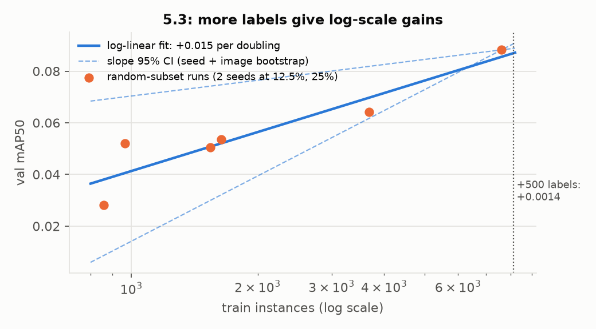

*Figure 21. 5.3 learning curve: random-subset runs, log-linear fit with its slope CI, and the +500-label marker.*

### 8.4 (5.4) Smallest subset reaching ≥ 90% of full-data performance (`src/subset_select.py`)

**Rule, frozen before any subset training** (`experiments/subset_rule.md`): strata by each image's rarest class; a per-stratum instance budget matched to the random runs; images ranked by their share of easy, medium and ambiguous instances (i.e. excluding hard-confused and hard-missed); 30 epochs for every size. An earlier revision that matched image counts was rejected before training because it gave 3,568 instances against about 912, a label-quantity confound.

**Table 17. Selected vs random subsets.**

| Budget | Random (range over seeds) | Selected (range) | Gap |
|---|---|---|---|
| 12.5% | 0.040 (0.028–0.052) | 0.040 (0.032–0.047) | 0.000 |
| 25% | 0.052 (0.051–0.054) | 0.037 (0.033–0.041) | **−0.015**, larger than both seed spreads |
| 50% | 0.064 (one seed; 73% of full) | — | — |
| **80%** | **0.080** (one seed; 91% of full; 357 images, 5,858 instances) | **0.085** (one seed; 96% of full; 300 images, 5,983 instances) | +0.005 (paired CI −0.007..+0.016) |

- **Smallest successful subset tested: 80% of the labelled instances.** 12.5%, 25% and 50% all fell short (50% random reaches 73%). The rule's provision for one extra size in the needed direction added f = 0.8, declared in `LOG.md` before training; both arms passed the 0.079 bar. The selected subset reaches **0.085 (96% of full data)** using **300 images (68% of the images) and 5,983 instances (79%)**; the random subset reaches 0.080 (91%) with 357 images. Selected vs full data: −0.003 (CI −0.019..+0.010), not distinguishable.
- **Class coverage of the successful subsets** (selected / random / full): Cargo 2,914 / 3,119 / 3,773; Box 1,989 / 1,678 / 2,366; Flatbed 498 / 507 / 662; Tractor 471 / 389 / 625; Liquid 111 / 165 / 192. The selected subset keeps more Box and Tractor and fewer Liquid; Liquid AP is 0 in both (0.008 at full data).
- **Not a proven minimum.** Sizes between 50% and 80% were not tested, each 80% arm is one seed, and the random arm passes by 0.0006, less than the seed spread at smaller sizes (0.003–0.024).
- **The declared rule did not beat random at small budgets, and tied it at 80%** (+0.005, CI −0.007..+0.016). The selected images had larger objects (29 vs 20–23 px), more ambiguous instances (48% vs 18%) and almost no hard ones (5% vs 27%): the rule removed exactly the small, confused examples that validation is full of. This matches the cartography literature, where easy-only subsets lose to random [34].

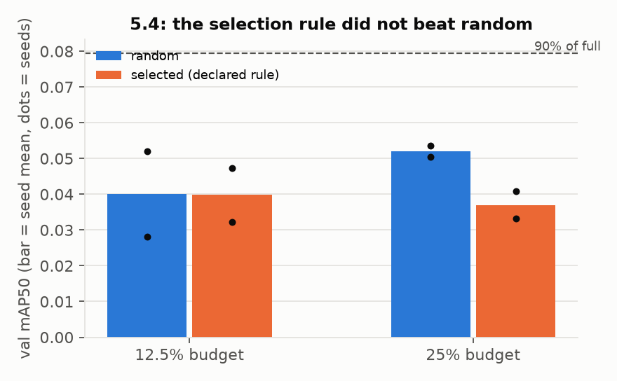

*Figure 22. 5.4 at 12.5% and 25%: random vs selected subsets with individual seeds; dashed line at 90% of full-data performance. The 50% and 80% results are in Table 17.*

---

## 9. Hypothesis ledger

**Table 18. Every hypothesis tracked from declaration to verdict.**

| ID | Hypothesis | Test | Status |
|---|---|---|---|
| H1 | too few pixels per object | E1 2× upsampling; recall by size; 3× probe | **supported** for 1× → 2×; 3× no further gain |
| H2 | subtype label noise | xView label comparison (§2.5); RFX3c | **inconsistency measured** in train rare classes (Liquid 0.52, Tractor 0.79), val consistent; causal effect on the model not established |
| H3 | genuine ambiguity at 0.3 m GSD | 5.1 with three classifiers; xView naming | **plausible; not separated from H2** |
| H4 | too little data | 5.3 learning curve | not the main limit in the tested range (+0.015 per doubling) |
| H5 | in-scope trucks left unlabelled | GTO test (§5.2) | **small effect** (+0.016 for an independent model; 94% of FPs remain errors) |
| H6 | under-training | E2, 100 epochs | rejected |
| H9 | scale augmentation shrinks tiny trucks | S1 (stacked) | not attributable |
| H10 | too few empty tiles cause FPs | FP location | weakened (65% of FPs within 320 px of a GT truck) |
| H11 | density shift hurts detection | density breakdown | no evidence of crowding failure |
| H12 | neighbourhood class consistency is unused signal | context rule + α = 0 control | **supported on YOLO** (+0.016 to +0.018); adds nothing on RF-DETR |
| H13 | the context gain is scene-level calibration | image-level rescoring | rejected |
| H-prior | an xView-pretrained detector carries a class prior 443 images cannot teach | RFX0 | **supported on validation** (0.195 zero-shot vs 0.139); generalisation not measured (§3.1) |
| H-collapse | fine-tuning on 443 images destroys rare-class discrimination | RFX1–3 diagnosis chain | **supported** (features drift; freezing the head is insufficient) |
| H-views | more test-time views per object help the zero-shot model | RFX0D; R8 | **supported** for 4 flips at 50% overlap (+0.069); 8 views hurt (−0.040) |
| H-scale | 4 val images are rescaled relative to train | scale audit; SC1 | **supported** (+0.023) |
| H-geom | damaging FPs have non-truck geometry | SP1 | rejected |
| H-rescore | a separate classifier can re-rank subtypes | T2, CB1, CB2, BX | rejected: no classifier beats the detector on held-out images |
| H-signal | a label-free feature separates FPs beyond confidence | `fp_signal.py`, held-out | rejected |
| H-clean | cleaning train labels repairs the rare classes | RFX3c / SC1c | **not supported; not refuted** (count and seed confounds, §7) |
| H-family | the YOLO family is the limit | Faster R-CNN; RF-DETR | weakened for the family; the prior, not the architecture, made the difference |

---

## 10. Literature: context and what it changed

**Table 19. Published reference points (indicative only; protocols, class sets and splits differ).**

| Source | Setting | Reported | Relevance |
|---|---|---|---|
| Lam et al. 2018 [1] | xView baseline, SSD variants, 60 classes | per-class AP for our trucks 0.005–0.474 (multi-resolution variant: Cargo 0.097, Box 0.086, Flatbed 0.126, Tractor 0.213, Liquid 0.474; row mapping inferred) | the same five classes; far from 0.75 |
| Sergievskiy & Ponamarev 2019 [2] | xView challenge winner | 28–32 mAP over 60 classes | the field's best average |
| Zand et al. 2021 [3] | 19 small-object classes | Cargo 0.135, Tractor 0.244 | best per-class Cargo / Tractor numbers found |
| Hurt et al. 2025 [8] | 11 modern detectors on xView | about 18–20 AP50 at best | no architecture solves xView |
| SAHI [4], ASAHI [5] | sliced inference on xView | 16–20 / 22–26 AP50 | slicing and overlap are the largest documented gains |
| Shermeyer & Van Etten [6]; Koester & Sahin [7] | super-resolution and upscaling on xView | +13–36% relative; nearest-neighbour upscaling equals learned SR | motivated E1; SR models not needed |
| FAIR1M [16] | fine-grained aerial vehicles | Truck Tractor from under 1 to 47 AP50 (%) depending on version and split | a different dataset; shows how unstable this class is |
| DN-TOD [15] | tiny objects with label noise | +2.3 AP50 from relabelling AI-TOD; class-shift noise destroys rare-class AP | the mechanism matching our fine-tune collapse |

**What the literature changed in the project:**
- **It set expectations honestly:** no comparable protocol reports anything near 0.75 on these classes.
- **It motivated three adopted changes:** upsampling (E1) [4, 6, 7], dense overlapping views (RFX0D) [4, 5], and repeat-factor sampling for rare classes (RFX3) [36, 39].
- **It explained Tractor's weakness:** the tractor cab is shared by four of the five classes in xView's naming [1].
- **It ruled out several detours,** saving GPU time: learned super-resolution [7]; Soft-NMS, which is worse than NMS in ASAHI's ablation [5]; zero-shot open-vocabulary detectors and geospatial VLMs, at 1–5% AP50 at this scale [25, 26, 28, 30]; test-time adaptation, which targets corruption shift [22]; and remote-sensing detectors whose training data already contains xView [25, 26, 27].
- **It shaped the label-noise reading:** DN-TOD's finding that class-shift noise hurts rare classes most while frequent classes barely move [15] matches both the fine-tune collapse and the one-directional conflicts in §2.5. It also warned that relabelling by a model's top class drifts labels towards the dominant class, which is why cleaning here used an external reference (xView) rather than the model.

---

## 11. Conclusions and next action

**Strongly supported** (measured; CI excludes zero or the effect is large):
- **The rare-class train labels are inconsistent with xView's; validation is consistent.** Train agreement with xView is 0.52 for Liquid and 0.79 for Tractor; validation agreement is 1.00. This is a measurement of label inconsistency, not of its effect on the model (see below).
- **Detection ranking is the first bottleneck.** Class-agnostic AP50 is 0.358 while 72–100% of GT are found at some confidence: trucks are detected but ranked below other vehicles and background.
- **Subtype confusion on located trucks is the second,** led by Tractor (matched-box accuracy 0.26; oracle +0.21 for that class).
- **Tiny objects and scale matter.** Upsampling gains concentrate below 24 px. The 4 rescaled validation images cost the pipeline, and normalising their scale recovers +0.023.

**Plausible but unresolved:**
- **The xView prior far exceeds what 443 images teach.** On validation the zero-shot checkpoint scores 0.264 against 0.139, and fine-tuning on the 443 images collapses the rare classes. How much of that gap holds on unseen imagery is not measured (§3.1).
- Train label inconsistency causes the fine-tune's rare-class collapse. It is consistent with the agreement numbers and with DN-TOD [15], but the clean-label fine-tune did not confirm it; §7 gives the competing explanations and the runs that would separate them.
- Cargo vs Box is genuinely ambiguous at 15–30 px without written visual definitions.
- Cars and vans become Cargo Truck on enlarged imagery because the prior is scale-specific.

**Rejected:**
- *More resolution, tiling or views closes the gap.* 8 views lost 0.040 (R8); the zero-shot model collapses at 2× (0.038); 3× upsampling and a P2 head gave nothing.
- *Post-hoc re-scoring fixes subtype.* Every attempt failed: crop classifiers (T2 on validation; CB1, CB2 and BX on held-out images), geometry (SP1), the head's competitor scores (CS1), context on RF-DETR (STK1), and logit and foundation-model probes.
- *Missing validation annotations explain the false positives.* With them added, about 94% of operating-point false positives remain errors.
- *More random labels are a good buy.* +500 labels ≈ +0.001.

**Highest-priority next action: an expert audit of the rare-class train labels.** The agreement numbers are the largest measured inconsistency in the data, and the one fix tried (relabelling to xView) was inconclusive, not negative.
1. **Audit.** Two annotators, blind to both label sources, label a stratified sample under a written visual protocol with an "uncertain" option: about 200 Tractor and Liquid boxes where our label and xView's disagree, 100 where they agree, and 100 of the empty boxes. This measures which source is right, and how often. Inter-annotator agreement (Cohen's κ on subtype) gives a human reference point for what these labels allow.
2. **Retrain, only if the audit finds the noise is real.** Fine-tune on the audited labels with the rare-class counts held equal to the original, 3 seeds per arm, against a matched control on the original labels; gate it on the 74 held-out train images before any validation run.

This is a better use of budget than another architecture sweep: the sweeps above have plateaued within 0.02 of each other, while the label defect is large and has not yet been tested cleanly.

**With more time and budget, in order:**
1. Score the final pipeline once on an untouched test set from outside xView, and confirm it across 3 training seeds; apply SC1's rule unchanged to imagery of mixed resolution.
2. A subtype classifier that beats the detector's own matched-box accuracy on held-out images (the gate CB1 and CB2 failed), aimed at Tractor and Cargo ↔ Box, where the oracle bound is +0.10.
3. Empty train boxes as ignore regions in fine-tuning, with a matched control, after the audit has classified them.
4. A cross-fitted learned context model for the YOLO line: the rule captures only +0.018 of the +0.12 headroom shown by a GT-context oracle.

---

## 12. Reproducibility

**Reproduce the results.**
- `bash reproduce_rfx.sh` (GPU recommended) downloads the public checkpoint, verifies SHA-256 checksums, runs RFX0D and RFX3 inference, fuses them, applies SC1 (`src/sc1.py`; expected 0.2975) and scores every stage. Before submission, FINAL2 (0.2742) and SC1 (0.2975, every per-class AP identical) were re-run from these commands and reproduced exactly.
- `bash reproduce.sh` reproduces the YOLO pipeline (expected 0.107 / 0.129 / 0.139). WBF and context reproduce byte-identically from the member prediction files.
- `python src/make_figures.py` and `python src/make_story_figures.py` regenerate every figure from saved results.

**Artefacts.** Weights and checksums in `weights/` (`SHA256SUMS`, `SHA256SUMS_RFX`); one config per run in `configs/`; every metric, match and prediction file in `experiments/results/`; frozen splits in `experiments/splits/`; the subset rule in `experiments/subset_rule.md`.

**External data.** The public RF-DETR checkpoint (`ShotaroFukunaga/rfdetr_xview`, `1008/checkpoint0099.pth`) and xView's labels for our images, used only for the forensics, the GTO test, the data audit and the label cleaning. URLs, SHA-256 checksums and the licence (CC BY-NC-SA 4.0) are recorded in `LOG.md`. The checkpoint was trained on xView, whose training split includes the 22 validation images; the YOLO pipeline and the 74 held-out train images are the independent references.

**Table 20. Run settings.**

| Run | Platform | Time | Epochs | Batch | Input | Data |
|---|---|---|---|---|---|---|
| E0 | Colab T4 | 1.9 h | 50 | 16 | 640 | full |
| E1 | Kaggle 2×T4 | 2.25 h | 50 | 16 | 1280 (2×) | full |
| E2 | Kaggle 2×T4 | — | 100 | 16 | 1280 | full |
| LC / 5.4 (10 runs) | Kaggle 2×T4 | — | 30 | 16 | 1280 | subsets |
| P3 (3 arms) | Kaggle 2×T4 | 2.3 h total | 30 | 16 / 8 | 1280 / 1920 | 25% |
| Faster R-CNN | Colab T4 | 4.6 h | 12 | 4 | 2× | full |
| RFX1 / RFX3 / RFX3c | Kaggle 2×T4 | RFX3c: 5 epochs × 15 min + inference (1.4 h) | 10 / 5 / 5 | 4 × 2 | 1008 px tiles (2× for RFX3, RFX3c) | full |
| Crop classifiers | Mac M5 / Kaggle | about 24 min each | 15 | 128 | 128 px crops | train |

**Software.** Python 3.12 (Mac) / 3.13 (Kaggle, Colab); Ultralytics 8.4.174; rfdetr 1.11.2; PyTorch 2.x; torchvision; timm 1.0.30; pycocotools 2.0.11 (verification only). A full `pip freeze` is saved for each Kaggle run. Seed 0 throughout unless stated.

---

## 13. Limitations

- **22 validation images.** Per-class claims for Tractor (117 boxes) and Liquid (20 boxes) are statistically thin; differences under about 0.02 overall cannot be resolved.
- **Selected on validation.** The best number is an optimistic estimate (§7). SC1 and the 18-image diagnostic subset were motivated by a validation audit.
- **Single seeds** for every full-data model; the only seed-variance evidence comes from the reduced runs (12.5%: 0.024; 25%: 0.003).
- **Pretrained checkpoint.** The checkpoint's xView training data includes the validation images, so the RF-DETR numbers are development results; the YOLO pipeline and the 74 held-out train images are the independent references.
- **No untouched test set and no multi-seed confirmation** of the final pipeline.
- **The label audit uses xView as the reference,** which is itself imperfect (QC precision 0.75); 102 train images could not be aligned and were left unchanged.
- **The forensics covers 13 of 22 validation images.** Visual checks (empty boxes, false-positive galleries) were done by a non-expert.
- **The noise-vs-ambiguity split for subtype confusions is not measured;** §11 gives the experiment that would measure it.

---

## References

1. D. Lam et al. *xView: Objects in Context in Overhead Imagery.* arXiv:1802.07856, 2018.
2. N. Sergievskiy, A. Ponamarev. *Reduced Focal Loss: 1st Place Solution to xView Object Detection in Satellite Imagery.* arXiv:1903.01347, 2019.
3. M. Zand et al. *Oriented Bounding Boxes for Small and Freely Rotated Objects.* IEEE TGRS, arXiv:2104.11854, 2021.
4. F. C. Akyon, S. O. Altinuc, A. Temizel. *Slicing Aided Hyper Inference and Fine-tuning for Small Object Detection (SAHI).* ICIP 2022, arXiv:2202.06934.
5. *ASAHI: Adaptive Slicing-Assisted Hyper Inference.* arXiv:2604.19233, 2026 (preprint).
6. J. Shermeyer, A. Van Etten. *The Effects of Super-Resolution on Object Detection Performance in Satellite Imagery.* CVPR Workshops 2019, arXiv:1812.04098.
7. E. Koester, C. S. Sahin. *A Comparison of Super-Resolution and Nearest Neighbors Interpolation Applied to Object Detection on Satellite Data.* arXiv:1907.05283, 2019.
8. Hurt et al. Benchmark of 11 transformer and CNN detectors on overhead imagery (xView, RarePlanes). arXiv:2508.02871, 2025.
9. *Joint-SRVDNet: joint super-resolution and vehicle detection.* arXiv:2005.00983, 2020.
10. J. Wang et al. *A Normalized Gaussian Wasserstein Distance for Tiny Object Detection.* arXiv:2110.13389, 2021.
11. C. Xu et al. *Detecting Tiny Objects in Aerial Images: A Normalized Wasserstein Distance and a New Benchmark.* ISPRS J. Photogramm. Remote Sens. 2022, arXiv:2206.13996.
12. C. Xu et al. *RFLA: Gaussian Receptive Field based Label Assignment for Tiny Object Detection.* ECCV 2022, arXiv:2208.08738.
13. *DQ-DETR: DETR with Dynamic Query for Tiny Object Detection.* ECCV 2024, arXiv:2404.03507.
14. *Dome-DETR: DETR with Density-Oriented Feature-Query Manipulation for Efficient Tiny Object Detection.* ACM MM 2025, arXiv:2505.05741.
15. *Robust Tiny Object Detection amidst Label Noise (DN-TOD).* arXiv:2401.08056, 2024.
16. X. Sun et al. *FAIR1M: A Benchmark Dataset for Fine-grained Object Recognition in High-Resolution Remote Sensing Imagery.* ISPRS J. 2022, arXiv:2103.05569.
17. J. Ding et al. *Object Detection in Aerial Images: A Large-Scale Benchmark and Challenges.* IEEE TPAMI 2021, arXiv:2102.12219.
18. *PETDet: Proposal Enhancement for Two-Stage Fine-Grained Object Detection.* IEEE TGRS 2024, arXiv:2312.10515.
19. *Orthogonal mapping for fine-grained object detection in aerial images.* IEEE GRSL 2024, arXiv:2407.17738.
20. *BHCL: Balanced Hierarchical Contrastive Learning with Decoupled Queries.* CVPR 2026, arXiv:2512.24074.
21. T.-Y. Pan et al. *On Model Calibration for Long-Tailed Object Detection and Instance Segmentation.* NeurIPS 2021, arXiv:2107.02170.
22. *STFAR: test-time self-training for object detection.* arXiv:2303.17937, 2023.
23. F. Liu et al. *RemoteCLIP: A Vision Language Foundation Model for Remote Sensing.* arXiv:2306.11029, 2023.
24. Z. Wang et al. *SkyScript: A Large and Semantically Diverse Vision-Language Dataset for Remote Sensing.* arXiv:2312.12856, 2023.
25. *LAE-DINO / LAE-1M: Locate Anything on Earth.* AAAI 2025, arXiv:2408.09110.
26. *RT-OVAD: real-time open-vocabulary aerial object detection.* arXiv:2408.12246; *OS-W2S.* arXiv:2505.03334.
27. D. Wang et al. *MTP: Advancing Remote Sensing Foundation Model via Multi-Task Pretraining.* arXiv:2403.13430, 2024.
28. *GEOBench-VLM: Benchmarking Vision-Language Models for Geospatial Tasks.* arXiv:2411.19325, 2024.
29. *EarthDial: Turning Multi-sensory Earth Observations to Interactive Dialogues.* arXiv:2412.15190, 2024.
30. *Do Open-Vocabulary Detectors Transfer to Aerial Imagery?* arXiv:2601.22164, 2026 (preprint).
31. *Fine-Grained Classification with Noisy Labels.* CVPR 2023, arXiv:2303.02404.
32. R. Solovyev, W. Wang, T. Gabruseva. *Weighted Boxes Fusion: Ensembling Boxes from Different Object Detection Models.* Image and Vision Computing 2021, arXiv:1910.13302.
33. D. Bolya et al. *TIDE: A General Toolbox for Identifying Object Detection Errors.* ECCV 2020, arXiv:2008.08115.
34. S. Swayamdipta et al. *Dataset Cartography: Mapping and Diagnosing Datasets with Training Dynamics.* EMNLP 2020, arXiv:2009.10795.
35. M. Toneva et al. *An Empirical Study of Example Forgetting during Deep Neural Network Learning.* ICLR 2019, arXiv:1812.05159.
36. A. Gupta, P. Dollár, R. Girshick. *LVIS: A Dataset for Large Vocabulary Instance Segmentation.* CVPR 2019, arXiv:1908.03195.
37. G. Ghiasi et al. *Simple Copy-Paste is a Strong Data Augmentation Method for Instance Segmentation.* CVPR 2021, arXiv:2012.07177.
38. M. Kisantal et al. *Augmentation for Small Object Detection.* arXiv:1902.07296, 2019.
39. *Instance-aware repeat factor sampling for long-tailed object detection.* arXiv:2305.08069, 2023.
40. M. Wortsman et al. *Robust Fine-Tuning of Zero-Shot Models.* CVPR 2022, arXiv:2109.01903.
41. M. Oquab et al. *DINOv2: Learning Robust Visual Features without Supervision.* arXiv:2304.07193, 2023.
42. Z. Liu et al. *A ConvNet for the 2020s.* CVPR 2022, arXiv:2201.03545.
43. Roboflow. *RF-DETR* (software, v1.11.2). github.com/roboflow/rf-detr.
44. Ultralytics. *YOLO11* (software, v8.4.174). github.com/ultralytics/ultralytics.
45. S. Ren et al. *Faster R-CNN: Towards Real-Time Object Detection with Region Proposal Networks.* NeurIPS 2015, arXiv:1506.01497.
46. T.-Y. Lin et al. *Microsoft COCO: Common Objects in Context.* ECCV 2014, arXiv:1405.0312.
47. Meta AI. *DINOv3* satellite backbone `facebook/dinov3-vitl16-pretrain-sat493m` (Hugging Face), 2025.
48. J. Hestness et al. *Deep Learning Scaling is Predictable, Empirically.* arXiv:1712.00409, 2017.
49. S. Fukunaga. *rfdetr_xview* (Hugging Face model repository `ShotaroFukunaga/rfdetr_xview`).
50. C. Northcutt, L. Jiang, I. Chuang. *Confident Learning: Estimating Uncertainty in Dataset Labels.* JAIR 2021, arXiv:1911.00068.
51. G. Huang et al. *Snapshot Ensembles: Train 1, Get M for Free.* ICLR 2017.

---

## Appendix A. Every configuration scored on validation

**Table A1. All runs (all 22 images unless stated). The complete per-class table for every run is generated in `experiments/results/per_class_all.md`.**

| Group | Runs (mAP50) |
|---|---|
| YOLO baseline and single changes | E0 0.073; E1 0.107; E1 class-agnostic 0.296; E1-2stage 0.1065; E2 0.107 (and epochs 40 / 60 / 80); E2 TTA 0.101; S1 0.090 |
| Context | E1_ctx 0.125; E2_ctx 0.123; context ×2 / ×3 0.1254 / 0.1248; GT-context oracle 0.229; 9-setting sensitivity grid 0.120–0.129; α = 0 controls 0.1074 / 0.1286; image-level calibration 0.124 |
| Ensembles | ENS_E2 0.129; ENS_E2_ctx **0.139**; ENS_multi_ctx 0.144; multi-label arms 0.1185–0.141 |
| Learned context | logistic regression 0.138; without detection weighting 0.131; gradient boosting 0.095 / 0.094 |
| Other families and probes | Faster R-CNN epoch 10 0.075; P3 3× / YOLO11m / DOTA 0.059 / 0.048 / 0.044; P4 NWD 0.049; P5 P2 0.0499 / 0.0449 |
| Learning curve and 5.4 | 12 subset runs, including the 80% random and selected runs (Tables 16, 17) |
| RF-DETR | RFX0 0.195; RFX0 at 2× 0.038; head re-maps 0.16–0.17; RFX1 0.058–0.067; RFX2 0.068 / 0.095; ENS_RFX 0.188; class-conditional fusion 0.200; RFX3 epochs 1–5 0.045–0.113; STK1 0.194; ENS_RFX03 0.226; snapshot / YOLO pushes 0.188 / 0.227; W1 0.143; V1 0.010; logit probe 0.143 |
| Dense views and FINAL | RFX0D 0.264; FINAL2 0.274; RFX3D 0.133; FINAL3 0.276 |
| Precision fixes | SP1 0.271; CS1 0.194; T2 0.136 |
| Diagnostics | GTO ×2 (13 images); FINAL2 at IoU 0.3 0.314; class-agnostic FINAL2 0.299, SC1 0.358 |
| Final round | SC1 **0.297**; FU1 / FU2 / FU3 0.284 / 0.254 / 0.287; FU1_SC / FU2_SC 0.307 / 0.279; R8 0.257; SC1c 0.278; RFX3c alone 0.136 vs RFX3 alone 0.141 |
| Crop classifiers (perfect boxes) | ConvNeXt-T 0.429; DINOv2 0.399; DINOv3-SAT 0.351 |

## Appendix B. File index

- **Training and inference:** `src/data.py`, `tile.py`, `train.py`, `nwd.py`, `predict.py`, `ensemble.py`, `context_smooth.py`, `context_model.py`, `frcnn.py`, `rfx_load.py`, `rfx_finetune.py`, `rfx_predict.py`, `rfx_dump.py`, `rfx_map.py`, `rfx_fuse.py`, `sc1.py`.
- **Evaluation and comparison:** `src/evaluate.py`, `compare.py` (`--same_images`, `--did`), `subset_map.py`, `density_breakdown.py`, `disagreement.py`.
- **Diagnosis:** `src/fp_forensics.py`, `gt_omission_test.py`, `gto_objects.py`, `fp_breakdown.py`, `image_audit.py`, `error_budget.py`, `fp_signal.py`.
- **Data audits and cleaning:** `src/eda.py`, `dataset_forensics.py`, `data_audit.py`, `align_xview.py`, `xview_coco_to_csv.py`, `clean_labels.py`, `context_radius_train.py`.
- **Investigations and classifiers:** `src/oracle_cls.py`, `two_stage.py`, `cartography.py`, `learning_curves.py`, `lc_interval.py`, `subset_select.py`, `subtype_bench.py`, `box_rescore.py`, `dinosat_oracle.py`.
- **Figures and report:** `src/make_figures.py`, `make_story_figures.py`, `build_report_pdf.py`, `build_report_docx.py`.
- **Records:** `experiments/LOG.md`, `DECISIONS.md`, `experiments/LITERATURE.md`, `experiments/LITERATURE_FULLREAD.md`, `report/literature.md`, `experiments/subset_rule.md`, `experiments/splits/`, `experiments/results/`.
